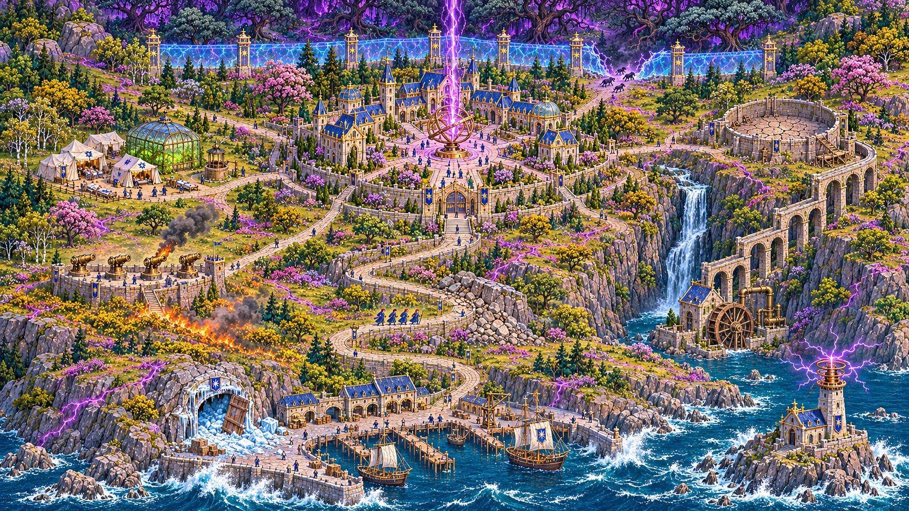

# The morning everything breaks: the order you learn the elements in

Brainstorm, 2026-11-16, for the user's idea: you learn an element when a machine that draws on that field spills it into you. The academy's district sits in an Arcane zone where every field is close to the surface. You start with Life, fix a run of urgent problems around the district, and end with Shield, because the root problem is that the ward to the wilds went down and creatures are spilling in. Everything here is a proposal. The [Morning Everything Breaks](https://claude.ai/artifact/9DwUCZHa8ibckf2vWiFews) page (`tools/element-order/`) shows it with concept images and holds the answers.

Pillars touched: 5 (told through places), 2 (each element should arrive in a situation that shows what it's for), 6 (the repairs are devices whose input is your spells, not minigames) and 3 (what a co-op partner does while you learn).

**Round 2 is current.** The first round below is kept as the record; [Round 2](#round-2-the-route-and-the-stops) replaces its order table with the user's answers, an independent review and a fleshed-out route. The fights at each stop, and the creatures, are in [the opening's encounters](2026-11-16-opening-encounters.md).

## What the user said

- The concept art is inspiration only: for layouts, for new asset types, mixing ideas between images. None of it ships.
- The overall map is blocked on not knowing the order of the elements and the scenarios they're learned in.
- Each time you interact with a machine that draws from a field, it spills over into you and you learn it.
- The Arcane zone is a sort of neutral zone where all fields are more available. All fields are always available to some degree, more so here.
- Start by learning healing, fix a bunch of urgent issues in the zone, and learn Shield at the end because the shields to the wilds went down.

From the 2026-11-15 scratchpad: Fire already has its segment (the battery), Life could be the healing tent, and healing is needed fast because the early game leans on melee with low regen.

## How it fits what's already approved

- **Arcane under everything** is already in [Element essences](../world/elements.md): Arcane is "the deep field" under every other field, and Attune floods every pool because the deep field feeds the others. The user's neutral zone follows from that. It also gives the incidents a common cause without answering why the veins shift (canon keeps that open): the academy's Arcane well is stuttering, and everything that draws on the fields above it is behaving erratically, some overflowing and some starving.
- **Innate casting is new** (canon). The spill is a concrete picture of how it happens to you, which canon didn't have yet.
- **Shield is a caster element, not a field.** It isn't drawn from the land, so nothing can spill it into you. That's the strongest part of the idea: every other element comes *to* you from a machine, and the last one comes *from* you, when there's no machine left to lean on. Shield as "the will to refuse" holding the gap is its essence as written.
- **Tension: the battery's first-cast moment.** Beats 4 to 7 are built around Fire. Driving the defence, the pool failing, then "you are the well" is the moment the opening is designed for. If Life comes first, Life is your first innate cast. See question 1.
- **Tension: "more available" and the regen total.** Canon says regions bend regen toward their element without changing the total (`q-2-total`). If "more available" means a higher total here, that's a change. Claude's reading: the Arcane zone is *even* (no element favoured), which suits a tutorial, and "more available" is the story's reason you can learn every element here. See question 4.
- **Tension: length.** The brief has the opening at about 30 minutes and the tutorial segment lasting until the base set is unlocked. Eight incidents at 3 to 5 minutes plus walking is nearer 50. Doubling up elements at one place, or a surge, brings it back. See question 3.

## Directions

1. **The triage morning (a linear chain).** One incident after another. Each fix's fallout points to the next: the dying battery turret sets the gorse alight, which is why you need the waterworks. In the hands: you always know where to go and why, and each new element arrives just as the last one's limits show. Partner: everyone gets the element at the same moment, as now. Closest to Magicka's linear chapters and to canon's "linear, region to region".
2. **The infirmary job board (a hub, any order).** Borrowed from *Breath of the Wild*'s Divine Beasts and Mega Man's stage select. The infirmary is home base, and the wounded who come in each name a broken machine. Pick your order; the ward line waits until every machine is running. In the hands: choice and ownership. Cost: every incident must work with any set of earlier elements, so you can't teach Water-then-Cold (freeze) or Water-then-Lightning in order, and the combos are the best part of pillar 2.
3. **The siege clock.** Borrowed from *Majora's Mask*'s moon. The ward fails in the first minute and you can see the breach from the road all morning. Creatures trickle in between every incident, more each time. In the hands: there's always a little pressure, and every repair also makes the district safer. Partner: someone covers the others while they work a machine. Cost: less room for the quiet experimenting pillar 4 promises, unless the fixed areas become safe zones.
4. **Confluence machines (two at a time).** Four or five incidents teach two elements each, at a machine that draws on two fields: the steam pump (Fire and Water), the harbor (Cold and Lightning), the cliff road (Earth with something). In the hands: you get a pair and immediately learn what they do together. Cost: half the "new rune" moments, and the pairs must not be opposites that cancel.
5. **Overflow and drought (the spill varies).** Not a full direction on its own, but a way to make every arrival different, which answers the scratchpad's worry about repetition. Some machines are *overflowing* and drench you (the infirmary lamp, the icehouse, the lighthouse coil); some are *starving* and you end up driving them until they're dry, then holding the line from your hands (the battery, the waterworks, the earth anchors). See the table below.
6. **The sponge (wild).** The spill is involuntary and happens mid-fight. You walk past a leaking coil while fighting and suddenly Lightning is on your bar. The repair *is* draining the overload into yourself. In the hands: surprise, and the world feels dangerous with magic. Cost: hard to teach on purpose, and a new rune mid-fight can be missed. It suits one incident well (the lighthouse) better than all of them.
7. **Gates (Metroid-style).** Borrowed from *Metroid*. Each element opens the way to the next: Water douses the fire across the road, Cold freezes the channel to the lighthouse causeway, Earth rebuilds the cliff path. In the hands: you use what you just learned straight away. Cost: lock-and-key edges toward pillar 6's warning about level gimmicks. Fine once or twice, dull as the rule.
8. **The surge first (wild, borrowed).** Borrowed from the opening of *Metroid Prime* and *Symphony of the Night*: you have everything, then lose it. When the armillary flares in the first minute, every rune lights for one short fight, then burns out, and you get them back one by one through the morning. In the hands: an early taste of what a full set feels like, which answers "melee alone isn't fun". Cost: it spoils the first-cast moment and the surprise of each new mix.
9. **Conservative (Magicka).** Magicka gives you nearly everything at once. Here: Life and Fire as now, then the existing "surge" proposal (beat 9 in the [opening brief](../campaign/01-opening/brief.md)) gives the rest at once, with Shield held to the ward line. Shortest, and the least worldbuilding.

## Claude's pick

**A linear chain (1) with varied spills (5), with a little of the siege (3) for pressure, and the user's ward line as the finale.** Combos need order, so the chain beats the hub. The varied spill is what keeps eight arrivals from repeating, and the visible breach means the morning has stakes without a timer. Doubling up at the harbor (4) is the easiest way to save time if it runs long.

### The proposed order

| # | Element | Place | What's wrong | How it reaches you | Teaches |
|---|---|---|---|---|---|
| 1 | Life | The field infirmary outside the gate | The mender's lamp is overflowing, and the glasshouse has grown wild overnight. Wounded are arriving from the ward line | Overflow. You carry the wounded through the lamp's light while the healers work, and it soaks in | Casting at allies on purpose, healing yourself. Support from minute one (pillar 3) |
| 2 | Fire | The battery (built) | The defence's well is failing | Drought. You drive it until it's dry, then hold from your hands (beats 4 to 7) | Casting modes, "you are the well", the blade |
| 3 | Water | The waterworks below the falls | The dying turret set the gorse on fire, and the pump's well has stalled, so there's no water to fight it | Drought. You crank the last water through, it runs dry, then you douse from your hands | Fire and Water: douse, steam, Wet |
| 4 | Cold | The harbor icehouse | Its frost well burst and is freezing the quay | Overflow. You're frozen in place for a moment and break out holding it | Water and Cold: freeze, ice underfoot |
| 5 | Lightning | The lighthouse coil | The coil is arcing wildly in a storm of its own, and ships can't come in | Overflow, mid-fight (direction 6). You're struck on the wet causeway | Wet and Lightning, chaining, and the first real friendly-fire lesson in water |
| 6 | Earth | The cliff road | The masons' anchor stones went dead, the retaining wall slumped and a rockslide blocks the road | Drought. You hold the anchor up until it's spent, then raise stone yourself | Walls, mass, Earth carrying Fire |
| 7 | Arcane | The academy courtyard, the armillary | The Arcane well under everything is stuttering, the common cause of the morning | Overflow. You step into the column | The beam, Attune, Life and Arcane cancelling. The reveal of why everything broke |
| 8 | Shield | The ward line | Three pylons are dark. Creatures pour through the gap | Nothing spills, because nothing is left to draw on. You refuse them yourself | Barriers, wards on allies, the parry. Then relight each pylon by feeding it the element its socket asks for: the final exam, using everything learned (pillar 6 devices) |

Sigil stays as canon has it: the etched focus gives Sigil with Conjure from beat 3, and the rest of its gestures are learned later.

**Why this order:** Life first covers the melee-heavy start. Fire stays where it's built. Water, Cold and Lightning are a run of Wet combos, each building on the one before. Earth is the "stuff" element, late enough that you have something for it to carry. Arcane is the cause and the strongest raw beam, so it comes just before the finale. Shield last fits the story and is the user's.

**What it costs:**
- Life first means your first innate cast is a heal, not a fireball: gentle, and a weaker power fantasy. The battery's "first rune" beat would become your second element (question 1).
- Shield last means no barriers, Blink or parry for most of the opening. The melee Defend covers some of it. The ward line is then also where you learn Shield, under the most pressure in the segment, so it needs a calm first minute behind the barricade.
- Eight places, each with its own art (the inspiration images show five of them), and one walkable route. That's a lot of map for a tutorial (question 3).

## The inspiration images

Generated with Codex on 2026-11-16 from Claude's prompts, using the user's harbor and academy concepts as style references and the district image as the reference for each close-up. They're in `docs/reference/element-order/`.

| Image | What it suggests |
|---|---|
| [District](../reference/element-order/district-v1.jpg) | All eight waypoints read along one road, with the cohort walking it. New: a dry, cracked round basin beside the pump-house (a ready-made arena) and the ward as glass-like panels between pylons |
| [Infirmary (Life)](../reference/element-order/area-life.jpg) | A walled ring with the lamp in the middle and tents around it, so the paths cross at the machine. It works as a hub. The lamp looks too much like the armillary; each field machine needs its own silhouette |
| [Waterworks (Water)](../reference/element-order/area-water.jpg) | The drained reservoir as a stepped arena with a sluice gate on each side. **Idea:** restoring the pump floods the basin mid-fight, so the same arena turns from dry to wet and teaches Wet on the spot. The sluices are entrances for enemies |
| [Harbor (Cold and Lightning)](../reference/element-order/area-harbor.jpg) | Both machines fit in one frame, which supports doubling up (question 3). The frost spreads as a fan across the quay, a ground state that grows. Workers shelter under an awning (people to protect). New creature: wolves with violet crystals on their backs, wildlife touched by the rifts |
| [Courtyard (Arcane)](../reference/element-order/area-arcane.jpg) | Seven coloured channels run out from the armillary, all dark but Arcane's. **Idea:** the courtyard is the morning's progress map, and each channel lights when its machine is fixed. Seen at the start, it tells players how many elements there are to find. Rift-touched deer, birds and wolves |
| [Ward line (Shield)](../reference/element-order/area-shield.jpg) | Three dark pylons with coloured sockets, the dome over the cohort, a guard post with a bell and sandbags, wounded guards. It puts the ward right behind the academy, closer than the district does, which raises the stakes. The open field between the gap and the wall is the fighting space |

## Asset types the images point to

Kinds of thing the current kits don't have, to consider when the places are designed:

- **A family of field machines.** One per element, sharing the academy's brass-and-stone language, each with its own silhouette and core colour: a lamp cage (Life), a ring of vessels (Water), a frost crystal in a frame (Cold), a coil (Lightning), anchor stones (Earth), the armillary (Arcane), pylons with sockets (Shield). Each needs working, overflowing, starving and dead states. The battery's turrets are the first of the family.
- **Ground states that spread:** a fan of frost, a dry cracked basin that floods, rift cracks, wet sheen, overgrowth creeping across paths.
- **Camp and siege dressing:** tents, cots and stretchers, herb racks, covered wagons, sandbags and barricades, a guard post with a bell.
- **Harbor and works:** water wheel, sluice gates, aqueduct, cranes, nets, piers, a boat locked in ice.
- **People at work:** healers, porters with stretchers, guards, harbor workers. Background characters who make it a morning in a real place, not an empty level.
- **Rift-touched creatures:** ordinary animals with violet crystals growing on them, a cheap way to vary the bestiary near Arcane.

## Questions for the user

On the review page, with answer boxes next to each.

1. **Life or Fire for your first innate cast?** (a) Life spills into you quietly at the infirmary and the battery stays "the moment" (Claude's pick: the overflow is a gift, the drought is a discovery). (b) The infirmary becomes the first-cast moment, and the battery is the second. (c) Fire first at the battery, then Life at the infirmary, where the battery's wounded are taken.
2. **A linear chain or an infirmary job board?** Chain (Claude's pick) for combos in order; board for choice.
3. **Eight stops, or fewer?** All eight; or six, with the harbor teaching Cold and Lightning together and Earth folded into the cliff road on the way to the ward (Claude's pick: six, to stay near 30 to 40 minutes).
4. **What does "more available in the Arcane zone" mean in numbers?** Even regen across every element, the same total (Claude's pick); or a higher total here, which changes `q-2-total`.

### The user's answers, round 1

On the page (`answers`, `ratings`):

| Id | Answer | Note |
|---|---|---|
| `q-1-first` | The infirmary is the first-cast moment | "This just seems right from a gameplay perspective. Life is also a more chill introduction to the cast mechanics." |
| `q-2-structure` | A linear chain | |
| `q-3-stops` | Six stops | |
| `q-4-arcane-regen` | Even regen, the same total | |
| `stop-life` | | The carrying is wrong. The well is connected to tools and devices the healers use; it's offline and you fix it, get infused in the process, and heal everyone there. Low stress, with the heal combinations shown on screen. The well comes back faint and needs time to regenerate, which is why you still need to heal. |
| `stop-water` | | Dousing fire is good; combat can be a side thing, with enemies to fight off everywhere as you reclaim things. Water might sit better next to Lightning or Cold for the combos. |
| `stop-cold` | | Arrive, fight some enemies, see the frost machine and fix it, which infuses you. Waves from the ocean during the fight could interact with the frost from the machine. |
| `stop-lightning` | | Water and Lightning is another good combo; maybe show a tip for drying yourself off. |
| `stop-earth` | | Needs more detail to judge. |
| `stop-arcane` | | "I'm not quite clear what players will actually do here." |
| `stop-shield` | | Suits a larger, longer battle by the forest edge. Flexible on Shield last; maybe allies fight here too. |
| `img-area-life` | Inspiring | Uses Life's growth as well as healing; the tents say it's a temporary setup. |
| `img-area-water` | Mixed | The wheel and the well's design are good, but with a natural waterfall it isn't clear what the Water element's job is, and the reservoir has no clear connection to anything. |
| `img-area-harbor` | Inspiring | The frost well as a harbor's icehouse is "exactly the type of creativity I was hoping for". Everything won't fit on one screen, but hints of each element can show as you come down. |
| `img-area-arcane` | (no mark) | The progress map could be a stop at the start that shows what needs doing, walked past a few times, though players might flex the order. The visual is inspiring. |
| `img-area-shield` | Inspiring | "Great visual." |
| `general` | | "I'm very happy with this brainstorm, it provides a lot of creativity and the concept art is great at fleshing it out." |

In chat, after reading an independent review of round 1: "Really successful overall." Flesh out the path and the individual sections more, and be generous with Codex images. On the review's points:
- Life before Fire is good: "You learn casting in a lower pressure environment, and without healing everything is much harder."
- The mechanism can largely be "you fix the thing and get the spell", with unique environmental effects in each area.
- The route has to be fixed. "We could make a sort of there and back route where we pass by arcane a few times."
- "We can maybe move shield earlier, and then make a bigger battle at arcane instead."
- Waves splashing at the harbor, not rain: "Being constantly wet is hard to work around."
- Sigil in the finale "could work". Shared regen with Life first is fine. The starter zone doesn't need to teach regen as a property of a place.

### What the independent review found

A fresh agent reviewed round 1 against the pillars and canon. Kept here because the user read it alongside the brainstorm.
- **Accepted and fixed in round 2:** droughts repeated the battery (now each stop is a fix with its own environment); carrying, cranking and being frozen weren't spells (now fixes use the hands or a spell); the route sent you back and forth with no shape, and Q3's six didn't add up; Shield last left no wards before Lightning's friendly-fire lesson; the parry belongs to the hands' Defend (taught in the drill yard), not to Shield; the blade is taught at beat 3, not at the battery; the waterworks had a waterfall running beside it; the harbor's rain made the whole arena wet.
- **Also from the review:** Sigil is a caster element like Shield, so the finale can be about shaping; the courtyard's seven channels are the seven fields, so Shield and Sigil aren't on that map; the honest length is nearer an hour; canon's "linear, region to region" is about regions, not the shape inside one.

## Round 2: the route and the stops

### The rule

**You fix the thing and get the spell.** Each stop has a machine that draws on a field, a fix you make with what you already have (your hands, or the elements you've learned), and an environmental effect that's that place's own. The machine comes back, and its field spills into you as it does. The fix always uses what you just learned, so each stop practises the last element while it hands you the next.

**Shield and the rule.** *Corrected by the user after round 2:* "It's totally fine that shield power comes from wells, but it's a little different since there's not a 'shield' (or sigil) field." The element notes' drain rules (Shield as concentration, Sigil as attention) describe the spell effect, not where the power comes from; Claude had misread them as lore and proposed that the pylons held the casters' stored will. That story is dropped. The ward pylons are machines fed by a well like any other, and relighting one teaches Shield. The only difference is that no Shield or Sigil field exists in the land, so there are no Shield or Sigil zones. A fitting source: the ward draws on the armillary, which is why it only holds while the armillary does. Question 2 below is answered by this.

### The route

There and back, with the courtyard as the knot. Every road leaves from it, and you cross it between stops, so the seven channels in its paving show your progress each time you pass.

| Pass | Where | Element | About |
|---|---|---|---|
| 0 | The courtyard: the briefing, the drill yard beside it | None (the focus gives Sigil with Conjure) | 10 min (beats 1 to 3) |
| 1 | The infirmary, just outside the main gate | Life | 5 min |
| 2 | Down the road to the battery | Fire | 8 min (beats 4 to 7) |
| | Back through the courtyard: the ward bell is ringing | | |
| 3 | The ward line, right behind the academy | Shield | 8 min |
| | Back through the courtyard, out to the gorge | | |
| 4 | The waterworks | Water | 7 min |
| 5 | Down to the harbor | Cold, then Lightning | 10 min |
| 6 | The cliff road, climbing back up | Earth | 5 min |
| 7 | The courtyard, the finale | Arcane | 10 min |

About 65 minutes with the walking, against the brief's 30. The tutorial segment runs until the base set is unlocked (canon), so the minutes are guesses until a blockout is played. If it runs long, the cliff road folds into the harbor's climb, or the infirmary and the battery share a fight.

**Why this order.** Life first, for the low-pressure first cast (the user). Fire stays where it's built. Shield third: you have something to protect your friends with before anything chains through them, and the ward's alarm is what pulls you back up the hill. Water, then the harbor straight after, so Wet leads into freeze and chain the moment you have them. Earth on the climb back, short. Arcane last, the cause and the biggest fight.

### 0. The courtyard, first visit

You come out of the briefing into the courtyard. The armillary stutters overhead and the seven channels in the paving are dim. The masters send the new cohort to help where it can: the infirmary first. This is where the drill yard (beats 2 and 3) can sit, beside the courtyard, so the map makes sense of the opening's first ten minutes.

### 1. The infirmary: Life, the first cast

- **The machine:** the healers' lantern-well. It feeds the tools they use: lamps over the cots, a healing bath, the glasshouse of medicinal plants.
- **What's wrong:** overnight, its own field ran wild. Vines from the glasshouse have grown over the conduits and choked the well dark, and the tools are dead. Wounded are coming in from the ward line.
- **The fix:** cut the vines away from the conduits with your hands and your conjured blade (the drill yard's lesson, used straight away). The last one frees the well. It relights faintly, and Life spills into you: the first-cast moment, with its own animation.
- **Then:** the well comes back faint and needs time to regenerate, so the healers need your hands. Heal everyone there. The heal combinations are shown on screen. No enemies, or only one or two strays.
- **The place's own effect:** healing blooms that grew overnight pulse a small heal to anyone near them. Vines creep back over the paths slowly.
- **Co-op:** heal the patients and each other. Healing a friend is always deliberate.

### 2. The battery: Fire (built)

Beats 4 to 7 as built: drive the defence, its well fails, the bar goes dark, and Fire arrives from your hands. With Life already yours, the moment becomes your second element and your first that hurts. The first real fight, survivable because you can heal. The place's own effect is the gorse fire on the slope below, set by the dying turret. It keeps burning, and spreads, while you're away.

### 3. The ward line: Shield

- **On the way:** crossing the courtyard back from the battery, you hear the ward's bell. One channel more glows in the paving.
- **The machine:** the ward pylons right behind the academy, each crowned with a crystal, with a coloured socket at its base.
- **What's wrong:** three pylons went dark when the armillary stuttered, and creatures are coming through the gap. Academy guards are holding the line and losing.
- **The fix:** each socket asks for an element you have. Feed Life and Fire into them while the guards hold. The first pylon relights, and its stored ward spills into you: Shield.
- **Then:** hold the gap with barriers while the last pylons recharge, and ward the guards fighting beside you. A larger fight than the battery, with allies.
- **The place's own effect:** the barrier panels between the lit pylons flicker on and off, opening and closing lanes along the line.
- **How it ends:** the gap closes, but the barrier still flickers. It will only hold while the armillary does, which is the finale's setup.

### 4. The waterworks: Water

- **The job, made clear:** the waterfall drops into a pool at the bottom of the gorge, and the academy, its cisterns and the burning slope are all up on the hill. The water is down there and the fire is up here. The Water well's job is lifting: its pump lifts the pool up the aqueduct to the big cistern beside the academy. It's steam-assisted, the Fire and Water confluence the element notes describe.
- **What's wrong:** the pump's boiler went cold when the armillary stuttered. The wheel has stopped, the aqueduct is dry and the cistern is empty, and the gorse fire is now at the cistern's sheds.
- **The fix:** relight the boiler with Fire, the element you learned two stops ago used on a device. The vessels glow, water surges up the aqueduct, and Water spills into you.
- **Then:** douse the gorse fire before it takes the sheds. Steam rises where water meets the burning gorse, which is cover. Creatures in the dry basin are a side fight while you work, as the user suggested.
- **The place's own effect:** the cistern is the arena, and it fills during the fight. A dry, cracked floor becomes ankle-deep water, so the same ground teaches Wet just before the harbor.

### 5. The harbor: Cold, then Lightning

- **The approach:** from the top of the stairs above the quay you see both machines: frost fanning out of the icehouse to the left, the lighthouse coil arcing on its islet to the right. Then you go down into the fight on the quay.
- **The place's own effect:** surf breaks over the quay's edge on a rhythm and leaves wet patches. It isn't rain, so you're wet only where you stand.
- **Cold:** the icehouse's frost heart burst its frame, and frost spreads across the quay. Where waves hit frosted stone, they freeze into ice sheets. The fix: melt the ice jamming the frame's door with Fire, and shut the frame. Cold spills into you, and now you can freeze the wet patches and the soaked creatures yourself.
- **Lightning:** the coil arcs into anything wet on the causeway, and the waves soak you as you cross. A tip appears: Fire dries you, and Wet fades on its own. Ward each other across, using the Shield from stop 3. The fix: at the top, strike the wrenched rod back into the coil. Lightning spills into you and the arcs settle.
- **Then:** the last fight on the wet quay. Lightning chains through soaked creatures, and through soaked friends. It's the first real lesson in friendly fire, with wards to answer it.

### 6. The cliff road: Earth

- **The machine:** the masons' anchor stones, carved standing stones banded with brass, which hold up the retaining walls of the switchback between the harbor and the academy.
- **What's wrong:** tremors from the stuttering armillary have shaken the road. One anchor went dark, its wall slumped, and a rockslide blocks the way up. Rift-touched creatures are coming down the slope.
- **The fix:** the anchor is half-buried in mud and rubble. Wash it clear with Water, the last element but two. It relights, and Earth spills into you.
- **Then:** clear the slide and hold the road as you climb. Tremors drop boulders from above, shown by a shadow before each lands. Raise Earth walls to shelter behind, and launch rock with Fire in it (Earth carries the other elements) to blast the slide off the road.
- **The place's own effect:** tremors, and falling rock you can see coming.
- **Short,** about five minutes. It's the first stop to fold elsewhere if the route runs long.

### 7. The courtyard finale: Arcane

The user asked what players actually do here. Round 2's answer:

- **Arriving:** six of the seven channels in the paving now glow. As you cross the courtyard, the armillary flares. The ward, which only holds while the armillary does, flickers out behind the academy, and creatures pour into the courtyard from the back. Masters, guards and the healers you helped fight alongside you. It's the biggest battle of the opening.
- **What you do:** the armillary's three great rings have slipped out of line. Each one has a lock at the edge of the plinth, a device that takes spells as input. Each lock asks for the elements of the channels beside it, so the finale uses everything you've learned. Defend a lock while one of you feeds it.
- **Arcane:** when the first ring locks, the column steadies enough to step into. Arcane spills into everyone at once, and the remaining two locks and waves are fought with the beam in hand: the opening's power moment.
- **How it ends:** the third ring locks, the column stands steady, the seventh channel lights, and the ward comes back up behind the academy. Why the armillary stuttered stays unanswered (canon). It's the year the veins shift.
- **Sigil:** locking a ring is binding magic into a lasting form, which is Sigil's essence. It could be where the masters recognise it and the rest of Sigil's gestures unlock, beyond the etched focus's Conjure. See question 5.
- **The place's own effect:** rift cracks in the paving flare along their length on a rhythm, so the ground itself pushes the fight around. Stones float above the cracks.

### Effects, one per place

| Place | Its own effect | What it asks of you |
|---|---|---|
| Infirmary | Healing blooms, creeping vines | Nothing hard: a calm place to learn casting |
| Battery | Gorse fire that spreads | Fire patches deny ground |
| Ward line | Barrier panels that flicker | Lanes open and close; watch the line |
| Waterworks | The cistern fills mid-fight | Dry ground becomes wet; steam where water meets fire |
| Harbor | Surf on a rhythm; frost that freezes waves | Wet patches come and go; ice sheets form |
| Cliff road | Tremors and falling rock | Watch the shadows, build cover |
| Courtyard | Rift cracks that flare | The floor pushes the fight around |

### Round 2 images

Generated from the round 2 district, with the camera reference as before. In `docs/reference/element-order/`.

| Image | What it shows, and what it suggests |
|---|---|
| [District](../reference/element-order/district-v2.jpg) | The route works as a shape: the courtyard in the middle, roads out like spokes, the ward right behind the academy with its gap, the lift from the waterfall's pool up the aqueduct to the cistern beside the academy, and the switchback with its slide between the harbor and the gate |
| [Machine family](../reference/element-order/machines-sheet.jpg) | Eight machines in one language, working above and broken below. Each silhouette is distinct, which fixes round 1's lamp-like-armillary problem. The broken states (vines, smoke, cracked vessels, a fan of ice, wild arcs, a tilted stone, slipped rings, a dark crystal) are what a player reads from a distance |
| [Courtyard, start](../reference/element-order/area-courtyard-start.jpg) | A real hub: a gate to each stop, the infirmary's tents and glasshouse beyond one, the drill yard with targets and dummies beside it, the brass works behind, stairs to the sea at the front. The masters brief the cohort on the plinth steps |
| [Infirmary](../reference/element-order/area-life-v2.jpg) | The conduits run like spokes from the well to the cots, the stills and the healing bath, so you can see what the fix brings back. The glasshouse's vines run along the conduits into the cage. Four zones round the well, one per healer's tool |
| [Ward line](../reference/element-order/area-shield-v2.jpg) | Guards and wizards fighting together in the open field before the gap, a wizard feeding fire into a dark pylon's socket while its crystal relights, the barrier half-faded next to the gap. The academy wall, gate and bell are right behind |
| [Waterworks](../reference/element-order/area-water-v2.jpg) | The lift reads at last: the aqueduct from the waterfall's pool, the wheel, the boiler with its firebox being lit, the ring of vessels, and the huge empty cistern with sluice gates, the burning sheds on its rim. The cistern is a very large arena; in the game it would be smaller |
| [Harbor](../reference/element-order/area-harbor-v2.jpg) | Stairs down from the top, the icehouse fanning ice on the left, surf breaking along the quay's edge and leaving it wet only there, the coil on the islet with its own small cloud. Ice floes by the frozen boat could be stepping stones |
| [Cliff road](../reference/element-order/area-earth.jpg) | Anchor stones glow at each bend of the switchback; the slipped one lies tilted in the slide while a wizard washes it with water, and three more shelter in a ring of raised stone from a falling boulder. Wolves come down the slide itself |
| [Finale](../reference/element-order/area-arcane-finale.jpg) | The biggest scene: crooked rings, the locks at the plinth, six lit channels, a horned boss through the back archway, masters casting from the stairs, healers in the corners. Busy enough to suggest the battle needs clear lanes (the channels could be them) |

New asset ideas from round 2: the healers' tools (lamps over cots, stills, a healing bath), conduits on the ground between a machine and what it powers, a boiler with an open firebox, sluice gates, terraced retaining walls with anchors at the bends, ring-locks, a horned boss from the wilds.

### Questions, round 2

1. **Shield earlier, at the ward line third, with the ward failing again at the finale?** Or Shield last, with the finale at the ward and Arcane before it?
2. **Is the pylons' stored will a good enough reason for Shield to spill?** Round 1 asked whether Shield should break the rule. Plainly: the element notes say Shield comes from the caster, not from a field, so a machine can't spill it. Round 2 says the pylons hold the will of the academy's casters, stored over years, and relighting one gives you that. Is that fine, or should Shield come differently?
3. **The finale's locks:** feed each lock the elements of its channels (Claude's pick), or something more physical?
4. **Order flex:** the user wondered whether players might flex the order. The chain keeps the combos in order; one flex point would be letting the harbor and the waterworks swap. Keep the chain strict (Claude's pick), or allow that one swap?
5. **Sigil at the finale:** unlock the rest of Sigil's gestures when you lock the rings (Claude's pick), or keep Sigil's growth for later in the campaign?
