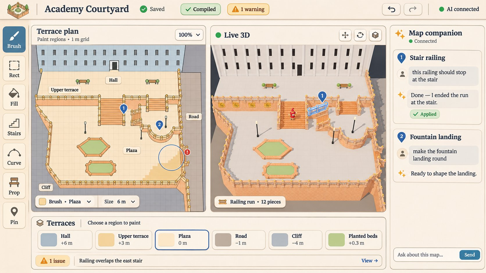
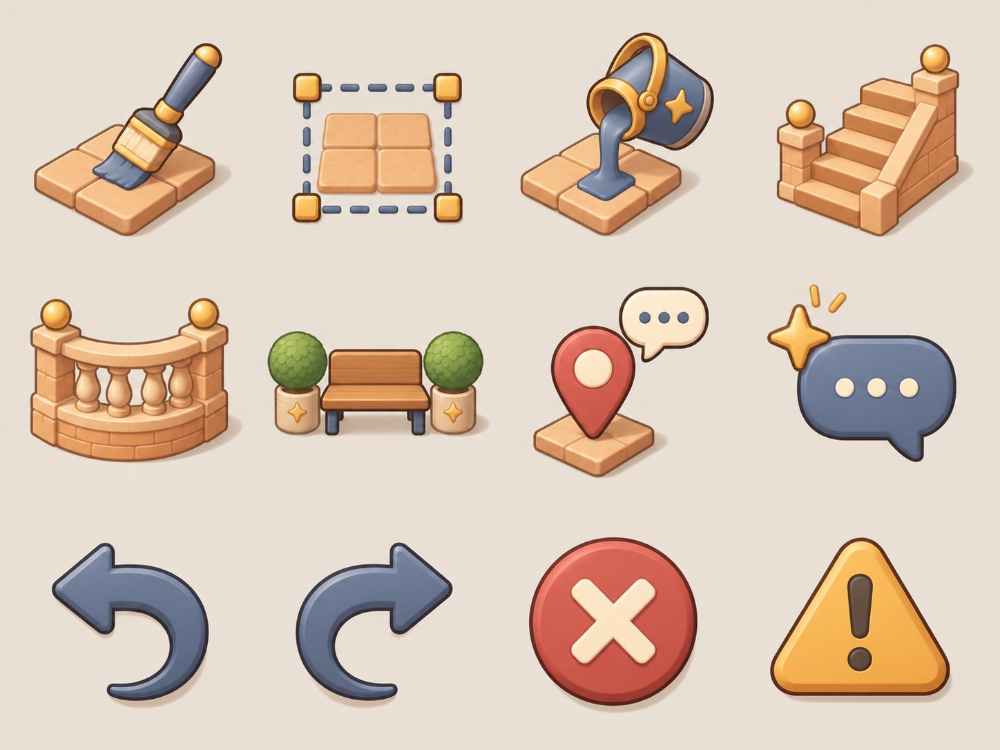
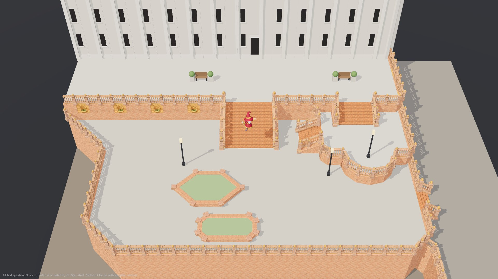

# A map editor the user and Claude share (2026-11-23)

**Status:** slice A built (2026-11-23), changed by the user's answers: edit in 3D, talk in the terminal, Claude edits directly ([what was built](#what-was-built-2026-11-23)). The spec below is draft 2 as reviewed; where the build departs from it, it says so there. Thread: [map editor](../threads/map-editor.md). It builds on [flexible building](2026-11-23-flexible-building.md): places are corner-grid layouts compiled by `tools/kit/compile.py` into made kit pieces and drawn by `game/packages/client/src/lab/kit3d.ts`.

How it was made: Claude (Opus) wrote it with a small team. A Sonnet agent surveyed the kit code. An Opus agent researched editors and LLM-connected tools ([what other editors do](#what-other-editors-do)). A guide agent checked the Claude Code docs on how a browser can push to a session. Fable gave an independent first opinion, then reviewed draft 1 ([the review](#fables-review)). Codex drew a mockup of the screen and an icon sheet ([pictures](#pictures)).

## What it should feel like

A session, as the user would live it, on patch B (the kit's traced test patch):

1. The user runs `npm run editor` and opens the editor. Patch B is there: a top-down plan on the left, the 3D view (greybox and the Meshy pieces made so far) on the right.
2. In the terminal, Claude says it can see the scene: "patch B, 34×24 cells, compiles with one warning: the fountain steps run straight into the grand stair."
3. The user paints the plaza two cells bigger. The plan repaints under the brush at once, and the 3D view catches up within a second. A red marker appears where the paint left an ambiguous cell; one more corner and it's gone.
4. The user drops three pins and types a note on each:
   - on the road gate: "this stair is awkward";
   - on the fountain landing: "make this round, and twice as big";
   - on a railing: "this run should stop at the stair, it looks odd".
   Then they press **Send to Claude**.
5. Claude reads the pins, the facts at each, and a picture of each spot. It answers each pin's thread in the editor:
   - the gate: "Moved the gate two cells south so its foot opens onto the road; the warning is gone."
   - the landing: "Made it a curve of radius 4. The bed under it moved one cell west to stay clear."
   - the railing: "That's a rule, not this map: the compiler should end a run where a flight's cheek wall starts. Filed as an issue for the kit."
6. Claude's changed cells glow for a moment. The user doesn't like the moved bed, so they click **Undo** on that reply and the bed is back. They write on the pin: "keep the bed, shrink the curve instead." Claude does.
7. The scene is a JSON file in git. The browser can be closed at any time. Claude can keep working without it, and the next open shows everything.

The test of the editor is steps 4 to 6: **pointing at a thing and having it dealt with should take less effort than describing where it is.**

Step 5's third answer matters. Many things the user spots aren't in the map at all: they're a rule in the compiler or a missing or bad kit piece. That's the [flexible building](2026-11-23-flexible-building.md#how-it-scales-the-user-out) page's whole claim: an issue fixed once in a rule or a piece is fixed for every place. So every pin ends one of three ways ([pins](#pins)).

## Principles

- **The plan is where you edit; the 3D view is where you judge.** The data is a corner grid, so painting in 2D is the natural and precise gesture. The 3D view is live and you can point in it, but nothing is edited there at first.
- **Edit meaning, never geometry.** The user and Claude both say "this corner is plaza", "a flight here", "a bench there". The compiler makes every piece. Neither side can express a broken join; that's the kit's point.
- **Pointing at a piece means pointing at what made it.** Click a railing and the editor knows it came from the plaza's parapet edge between two corners, and that's what the pin records. Claude then changes the terrace, the rule or the piece, never "the railing".
- **Fast, honest feedback.** The plan repaints under the brush at once. The compile follows in a worker, so the page never waits, and the 3D view lags by up to a second. Errors and warnings appear on the plan where they are, as in TrenchBroom's issue browser, not in a log. There's no build button.
- **Bad states are allowed.** Painting passes through ambiguous cells all the time. The editor saves any state, keeps showing the last good 3D with the errors on top, and never refuses a stroke.
- **Everything can be undone, and every edit has an author.** Each change is an op tagged `user` or `claude` in one history. Claude's edits are grouped per turn, so one turn undoes as a whole.
- **One source of truth, on disk.** A local server owns the scene file. The browser and Claude are both its clients. Git sees every saved state.
- **Pins, not descriptions.** A pin is anchored to an object or a spot, so "this" means the same thing to both sides, even after edits (tldraw's ["agents can't point"](https://tldraw.dev/blog/agents-cant-point)).
- **Claude sees what the user sees.** Claude gets structured facts at a spot (which terrace, heights, which pieces, which errors) and a picture of it. It doesn't read text grids, which LLMs miscount. Before resolving a pin, Claude looks at the result.
- **Cheap editor, rich kit.** What places can be is limited by the kit's vocabulary (ramps, slopes, free curves, towers), not by the editor. Keep the editor small and let it grow with the kit. The scene format carries a version for that.
- **Dev only.** The editor never ships in the game build, since main deploys on every push.

## The screen

*Superseded 2026-11-23: the user chose to edit in 3D; the build has one 3D view, with a top-down camera for the plan ([what was built](#what-was-built-2026-11-23)).*

```
┌────────────────────────────────────────────────────────────────────────────────────────┐
│ patch B ▾   rev 142 · saved · 0 errors, 1 warning              [Undo] [Redo]  ● Claude  │
├────────┬─────────────────────────────────────┬──────────────────────────┬──────────────┤
│ TOOLS  │  PLAN (top-down, corner grid)        │  3D VIEW                 │ PINS         │
│ ◻ Brush│  ┌──────────────────────────────┐   │                          │ ⚑1 "this     │
│ ▭ Rect │  │ hall ███████████████  road ░░│   │   live; orbit, pan,      │ stair is     │
│ ◪ Fill │  │ terrace ▒▒▒▒▒▒▒▒▒▒▒▒▒▒   ░░│   │   zoom, game camera      │ awkward"     │
│ ⇅ Stair│  │ plaza ····· ⚑1 ···· ⊗  ░░│   │                          │  Claude: …   │
│ ✦ Prop │  │ cliff                      │   │                          │  [Undo][↩]   │
│ ⚑ Pin  │  └──────────────────────────────┘   │                          │ [Send ⏎]     │
├────────┼─────────────────────────────────────┴──────────────────────────┴──────────────┤
│ PALETTE│  1 hall 11 m wall · 2 terrace 2.1 m parapet · 3 plaza 0 m parapet · 4 road …  │
│ REPORT │  △ the road gate: wall in front of its foot          [jump] [send to Claude]   │
└────────┴──────────────────────────────────────────────────────────────────────────────────┘
```

- **Top bar:** the place, the revision, save state, the compile summary, undo and redo, and whether Claude is connected.
- **Plan:** the corner grid in terrace colours, with the compiled outlines on top (edges, flights, curves, props). Hovering shows the corner, the terrace and the height. Pan with space-drag or the middle mouse button; zoom with the wheel.
- **3D view:** `kit3d.ts`'s renderer made live, with orbit, pan, zoom and a snap to the game camera.
- **Pins panel:** each pin's thread, and the pins not yet sent. It's for pins only. A free note to Claude is a pin with no anchor. Ordinary conversation, and Claude Code's permission prompts, stay in the terminal.
- **Palette:** the place's terraces as swatches (name, height, edge treatment), numbered for the number keys. Click one to paint with it, double-click to edit it, and + adds one.
- **Report:** every error and warning. Each one jumps to its place, and **send to Claude** turns it into a pin.

## What the user does by hand

**Slice A** (the first build, [below](#building-it)):
- **Paint terraces** with a brush that covers a whole cell (2×2 corners) by default and grows with [ and ]. Alt paints a single corner, for fine outlines and chamfers.
  - Tiled's corner brush defaults to one corner, but in Tiled every corner pattern has a tile. In our kit, two diagonal corners make an ambiguous cell the compiler refuses, so a one-corner default would make errors with nearly every stroke. A whole-cell brush makes them rare, not impossible: two diagonal strokes that touch at a corner still make one.
- A rectangle tool and a flood fill. Number keys pick the terrace; I picks the terrace under the cursor (an eyedropper).
- **Edit terraces** in the palette: name, height, material, edge treatment (wall, parapet, retaining, open), walkable.
- **Undo and redo.**
- **Pins on the plan** with a note, and **Send**.

**Slice B:**
- **Pick in 3D:** hovering highlights the piece under the cursor and the cells it came from; clicking selects it or drops a pin there.
- **Place a flight** by dragging along a terrace edge. The editor works out its direction and its top and bottom terraces from the corners, and shows its landings.
- **Place, move, turn and delete props** (vignettes), with their clearance boxes drawn.
- **Doors:** click a wall edge.
- **Select and inspect** anything: its fields, its id, its errors.

**v1, after that:**
- Hotkeys for every tool.
- Layers you can hide (floors, edges, props, errors, pins), and a toggle between the flat terrace view and the dressed 3D (LDtk's raw-data view).
- Resizing the map by adding or removing rows and columns at an edge; objects and pins move with them.
- Dragging a flight's ends to resize it.
- Icons, swatches and piece thumbnails drawn by Codex (the user, 2026-11-23: "For UI elements you can use codex to generate art"; [first pictures](#pictures)).

**Later:** a curve tool (until then, curves are Claude's or the inspector's), props as a theme plus a seed with a reroll button (Dungeon Alchemist's fill), copy and paste of regions, history you can scrub through, a walk mode (drop a wizard in and walk the place; it needs kit places in the sim first), several places side by side, and editing in 3D.

**Not planned:** piece authoring (that's Meshy and `fit.py`), free geometry, and several people editing at once.

## What Claude does

Claude works through a few tools. The same operations exist as HTTP endpoints and as a CLI (`node tools/map-editor/cli.mjs`), so Claude can work through Bash before the MCP bridge exists, or without it.

| Tool | What it does |
|---|---|
| `scene_get` | The scene: terraces, corner rows, objects with their ids, the revision. Optionally only a region. |
| `scene_query` | Facts at points or in a region: the corner and terrace, heights, which instances sit there and which object or edge made them, and the errors and warnings there. This is how Claude knows what "here" is without counting rows. |
| `scene_apply` | An atomic batch of ops against a base revision. It returns the new revision and **a diff of the compile report**: errors and warnings added and resolved, and changes in piece counts. `dry_run` compiles without saving. |
| `scene_undo` | Undo one of Claude's turns. |
| `view` | A PNG of a region of the plan, the 3D view or both, from the open page, with pins and errors drawn on. |
| `pins_inbox` | Pins sent and not yet resolved, each with its note, its anchor and the facts at it. |
| `pin_reply` | Reply on a pin's thread, and optionally resolve it with an outcome. |

**Ops** (what `scene_apply` takes):
- `paint_corners` (a list or a rectangle, to a terrace)
- `add_terrace`, `set_terrace`, `remove_terrace` (refused while corners still use it)
- `add_flight`, `add_curve`, `set_curve`, `add_door`, `place_vignette`
- `move`, `turn`, `set`, `remove` (any object, by id)
- `insert_rows`, `insert_cols`, `remove_rows`, `remove_cols`
- `set_meta`

Ops name objects by id. Pins have their own calls (`pin_add`, `pin_reply`, `pin_resolve`), outside the scene's history. Claude can still edit the file directly, as an escape hatch: the server notices, and the change loses its authorship and resets the undo history ([saving](#saving-and-history)).

**How Claude finds out the user pointed at something:**
1. **A prompt hook (slice A).** A `UserPromptSubmit` hook prints the pins waiting in the inbox, so typing anything in the terminal ("go") brings them in. It's cheap, certain, and needs no preview features.
2. **A channel (slice B).** Claude Code's [channels](https://code.claude.com/docs/en/channels) (a research preview) let a local MCP server push an event into the running session. **Send** becomes a `<channel source="map">` message and Claude starts on it; `pin_reply` answers in the editor. A custom channel isn't on Anthropic's allowlist, so it needs `claude --dangerously-load-development-channels server:map` and an interactive session. To check when building it:
   - that an event starts a turn in an idle session;
   - that events sent while Claude is mid-turn queue (the docs say they arrive together on the next turn);
   - how permission prompts behave in such a turn (allow the map tools in the project settings so they don't stop it).
3. **Asking:** "check the map" → `pins_inbox`.

If Claude isn't connected, **Send** says "queued: Claude isn't connected", and the pins wait in the inbox.

**Claude's edits apply directly, not as proposals.** Ghost proposals that the user accepts were the research's recommendation, after tldraw and Miro. They would need a second compile, a diff drawn in 3D, and an approval step on every change, which slows the loop the editor exists for. Spline's agent works the other way: its edits are ordinary edits in the undo history, and the user can take over at any point. We do the same. Claude's edits land at once, glow in the plan, and undo as one turn. For large restructures, Claude can `dry_run` first and show a `view` of the result.

If direct edits feel too loose, a *proposal mode* can come later. Claude's turn would then arrive as a proposal: added pieces tinted green, removed ones red, changed corners outlined, with the report's diff ("fixes 2 errors, adds 0"). Accepting it is one undo step. `dry_run` already gives the server what that needs.

**The tool count is kept small on purpose.** The Unity and Godot servers, with 30 to 180 tools, crowd the model's context, and some now make tool groups opt-in. Patch B (34×24 cells) fits whole in one `scene_get`. Detail levels for large places can wait until a place is large.

## Pins

A pin is `{id, note, author, anchor, rev, status, outcome, thread[]}`.

- **Anchored to an object** (a flight, curve, door or vignette), by the object's id. The pin follows the object through edits and only breaks if the object is deleted.
- **Anchored to a spot** (ground, an edge, a piece that came from an edge), by grid coordinates plus the terrace there. Regions have no identity (patch B's two beds are both `L`), so coordinates are the honest anchor. Resizing is an op that moves pins along with everything else.
- Each pin keeps a small fingerprint of the corners around it. If they change, the pin says "the scene changed here" rather than guessing.
- A pin dropped in the 3D view also records the camera, so Claude's `view` can show the same angle.
- **Every pin is resolved with one of three outcomes**, and Claude says which:
  - `scene`: fixed in this map. The reply names the change, which can be undone from the reply.
  - `rule`: the compiler's behaviour is wrong everywhere (a run that ends oddly, a variant in the wrong place). Claude files a GitHub issue with the `file` skill and links it, and doesn't contort the map to hide it.
  - `piece`: a kit piece is missing or bad (a curved ramp, a pier that looks wrong). Filed the same way, for the kit.
- Pins live beside the scene (`<place>.pins.json`), so scene diffs stay clean. Resolved pins stay as the place's review record.

## The scene format

The scene becomes data: `tools/kit/scenes/<place>.scene.json` is the one source of truth.
- Python can't be written back by an editor without losing its structure, and the browser can't read it.
- Python layouts go through a one-time converter, and their comments become `notes` fields.

```json
{
  "schema": 1,
  "name": "patch B",
  "G": 2.0,
  "terraces": [
    { "id": "t-hall",     "glyph": "B", "name": "the hall",            "h": 11.0, "mat": "roof",    "edge": "wall" },
    { "id": "t-fountain", "glyph": "F", "name": "the fountain landing", "h": 1.05, "mat": "paving",  "edge": "parapet" },
    { "id": "t-plaza",    "glyph": "P", "name": "the plaza",            "h": 0.0,  "mat": "plaza",   "edge": "parapet" },
    { "id": "t-cliff",    "glyph": "C", "name": "the cliff below",      "h": -4.0, "mat": "rock",    "edge": "open", "walk": false }
  ],
  "corners": [
    "BBBBBBBBBBBBBBBB",
    "PPPPPPPPPFFFFFFF",
    "CPPPPPPPPFFFFFFF"
  ],
  "objects": [
    { "id": "f-grand",   "kind": "flight",   "name": "the grand stair", "head": [[13, 8.5], [17, 8.5]] },
    { "id": "c-bastion", "kind": "curve",    "name": "the fountain bastion", "terrace": "t-fountain",
      "centre": [24, 13.5], "r": 2, "ends": [[22, 13.5], [26, 13.5]], "out": "S" },
    { "id": "d-hall",    "kind": "door",     "at": [15.5, 2.5] },
    { "id": "v-lamp-1",  "kind": "vignette", "piece": "vignette.lamp", "at": [10, 13.5], "front": "S" }
  ],
  "notes": "Traced from a free Codex painting; what the kit can't say yet: …"
}
```

- **Corners stay as text rows.** They diff well, the user can read them, and they're compact. Each character is a terrace's `glyph`, while its `id` is its identity, so re-lettering never breaks a reference.
- **The server mints ids once.** They are never reused and never derived from names.
- **What the compiler can derive isn't stored.** A flight's top, bottom and direction follow from the corners at its head, and storing them is where edits drift. A curve keeps `out`: its centre sits on its chord, so the side it bulges to can't be read from its geometry.
- **`schema` has a version,** because ramps, slopes and free curves are coming.

## How it fits together

```
 browser: the editor page (Vite dev only: game/packages/client/editor.html)
   plan · 3D view (kit3d renderer) · pins panel
        │  WebSocket: ops up; revisions, compiled output and pins down
        ▼
 scene server (Node, tools/map-editor/, 127.0.0.1:8790)       ◄── watches tools/kit/scenes/
   owns the scene · history with authors and revisions · pins
   compile worker: one long-lived Python process running compile.py (JSON lines in and out)
   HTTP API: the same ops and queries as the tools
        ▲                                ▲
        │ HTTP                           │ HTTP and an event stream
 CLI (Bash; slice A)              map bridge (stdio MCP server that Claude Code starts; slice B)
 + UserPromptSubmit hook            tools → HTTP · declares claude/channel · pushes "pins sent"
                                          ▲
                                    Claude Code session
```

- **The scene server runs as its own long-lived process,** so the editor works without Claude and Claude works without the browser.
- **The server is Node, not Python.** Fable recommended one Python process, with the compiler in-process. The ops, their validation and their inverses are written once in TypeScript and shared with the page, which applies a stroke to the plan at once, before the server confirms it. That shared code is the reason for Node. The cost is four processes (Vite, the server, the Python worker, the bridge) and handling a worker crash: restart it and recompile. `npm run editor` starts them all, and `tools/servers/` learns the new server. Porting the compiler to TypeScript waits until the game needs kit places at run time.
- **The bridge is a thin stdio process,** because channels must be stdio. If the scene server isn't running, its tools say "start it with `npm run editor`" rather than failing to connect when the session starts.
- **Concurrency:** one user and one Claude don't need a CRDT; Figma doesn't use one either. The server puts all ops in order in one history. Each `scene_apply` names its base revision. If an op touches a corner or object changed since that revision, it's refused with what changed, and Claude re-reads. The user's painting is never blocked.
- **Dev only:** the Vite build takes `index.html` as its only entry, so lab pages like `kit3d.html` and `editor.html` never reach the build. The server listens on 127.0.0.1 only.

### Saving and history

- Every op writes the scene file atomically (a temporary file, then a rename). The history is appended to `<place>.history.jsonl`, so undo survives a server restart.
- **Undo is one linear history with labelled groups.** Ctrl+Z undoes the latest group, whoever made it, and a toast says whose. **Undo** on a Claude reply reverts that turn even if the user has edited since. This is done as an inverse op appended as a new revision, not by rewinding. If the user has since touched the same corners or objects, the undo still applies and the compiler flags whatever breaks.
- The watcher ignores the server's own writes (it compares the file's hash with the last one it wrote). Any other change to the file (Claude's `Edit`, a `git checkout`) becomes one revision authored `external`, and undo can't go back past it.

## Compiler changes it needs first

From the survey of `compile.py`:
- **Take a scene dict,** not a layout name loaded with `runpy`.
- **Structured findings:** `{code, severity, msg, at: [x, y], refs: [ids]}`. Today findings are strings, and several have no location at all, so the editor couldn't place them: a flight's landing not clear, two flights overlapping, ground no flight reaches, and both warnings.
- **Instances carry where they came from:** the object or terrace edge that made them, plus a stable key, so hovering a piece finds its source and pins anchor to it.
- **Stable variants.** Windows alternate on a counter that runs across the whole map (`compile.py:196`), so painting one corner can flip every window after it. Make the choice depend on position, as the niche rule already does.
- **Time the compile inside a running worker.** 0.6 s includes Python's start-up. If the warm compile is still slow, recompile only the changed region.
- **Per-cell reachability,** later. Today it's per terrace, so "can't be reached" can't point at the cells.

## Building it

**Slice A: the loop, through the terminal.**
1. The compiler changes above, and patch B converted to `patch-b.scene.json`.
2. The scene server with its history, the compile worker and the WebSocket, plus the CLI.
3. The editor page: the plan with brush, rectangle, fill and eyedropper; the palette; undo; error markers; the 3D view live but not clickable; pins on the plan, and **Send**.
4. The `UserPromptSubmit` hook that brings sent pins into the session.
5. **The test:** the user and Claude fix patch B's awkward road-gate stair without the user typing a coordinate.

Steps 1 and 2 already improve today's way of writing layouts as Python by hand. Slice A tests whether the loop is worth having before anything is spent on the channel or the panel.

**Slice B: tight.** The bridge and the channel, the pins panel with threads and replies, picking in 3D with each instance traced to its source, the flight, prop and door tools, and undo on a reply.

**Then v1 and later,** as listed in [what the user does by hand](#what-the-user-does-by-hand).

## Risks

- **The kit limits what places can be, not the editor.** The patch B trace lost ramps, sloping roads and free curves. A polished editor over a thin kit gives polished disappointment, so the editor stays cheap until the kit grows. The `rule` and `piece` outcomes feed the kit from the editor.
- **Channels are a research preview.** The flag or its behaviour may change. The hook and the CLI keep everything working without it.
- **Claude's spatial reading.** Text grids get miscounted. The tools answer with coordinates, facts and pictures instead.
- **Four processes on Windows.** One command starts them, and the worker restarts itself.
- **Kit places don't reach the sim yet.** The game's ground still comes from LDtk rooms. A walk mode needs the kit's floors in the sim first, which is the height thread's work, not the editor's.

## What other editors do

The research covered level editors, for what makes them pleasant, and LLM-connected tools, for how the model sees, points and edits. Facts marked *(unverified)* are from memory.

**Level editors.**
- [Townscaper](https://pcgamer.com/townscapers-developer-on-how-its-radically-casual-design-is-inspiring-a-new-wave-of-low-stress-builders-to-adapt-the-blueprint): "a clear division of labor between the user and the algorithm". You add or remove a block, and the solver picks every piece. That's our corner data and compiler.
- [LDtk](https://ldtk.io/docs/general/auto-layers): you paint semantic IntGrid values, auto-layer rules make the tiles, and Shift+R hides the art to show the raw values. That's our flat view.
- [Tiled](https://doc.mapeditor.org/en/stable/manual/terrain/): corner terrain sets with a corner brush (one corner by default, Ctrl for the whole tile). The reference for painting corners.
- [TrenchBroom](https://www.moddb.com/features/trenchbroom-2s-creator-on-making-a-new-level-editor-for-classic-shooters): direct manipulation over forms, edits that can't make invalid brushes, and an issue browser that finds problems as you edit and offers one-click fixes. That's our report panel.
- [Super Mario Maker](https://www.nintendolife.com/news/2015/09/interview_yosuke_oshino_on_the_origins_and_evolution_of_super_mario_maker): few buttons by design, and edit and play switch instantly from the same spot. That's our later walk mode.
- [Dungeon Alchemist](https://store.steampowered.com/app/1588530): draw a room and pick a theme; the fill is procedural, you can reroll it, then override anything. Our later prop themes.
- [WorldEdit](https://worldedit.enginehub.org/en/7.0.1/commands/): the selection is a noun you hand to commands, and here to Claude.
- [Tiny Glade](https://80.lv/articles/exclusive-tiny-glade-developers-discuss-bevy-proceduralism-publishers-cozy-games): the hardest part was iterating on the UX. Snapping is on by default and Ctrl turns it off, and the tools react to each other.
- The Sims' roofs, which don't follow the walls, are the warning case *(forum complaints)*: derived parts must follow edits. Our compiler gives us that for free.

**LLM-connected tools.**

| Tool | How the model edits | How it sees | Pointing | Undo |
|---|---|---|---|---|
| [Blender MCP](https://github.com/ahujasid/blender-mcp) | arbitrary Python | JSON summary and renders | none | Blender's; the README says save first |
| [Unity MCP](https://coplaydev.github.io/unity-mcp/reference/tools/core/manage_gameobject) | ~47 CRUD tools, `batch_execute` | hierarchy JSON, screenshots | editor selection *(unverified)* | Unity's |
| [Unity Assistant](https://docs.unity.cn/Packages/com.unity.ai.assistant@2.0/manual/checkpoints.html) | scene CRUD | hierarchy | selection | a checkpoint per prompt |
| [Godot MCPs](https://godotengine.org/asset-library/asset/5544) | 30 to 187 node tools over a local WebSocket | scene tree as a resource | varies | varies |
| [Figma MCP](https://developers.figma.com/docs/figma-mcp-server/write-to-canvas) | Plugin API code | structured nodes and screenshots | current selection | history; "work in smaller steps" |
| [tldraw agent kit](https://tldraw.dev/starter-kits/agent) | typed actions; a sanitizer repairs bad ids | screenshot plus shapes at three levels of detail, plus lints | selection, areas, [pinned comments](https://tldraw.dev/blog/agents-cant-point) | store history |
| [Spline agent](https://docs.spline.design/spline-ai/ai-agent) | the editor's own tools | the scene, plus screenshots to check its work | selection | ordinary edits in the history |
| [Roblox Studio](https://create.roblox.com/docs/studio/mcp) | scripts and instances, playtests | tree and console | selection *(unverified)* | Studio's |
| [React Grab](https://github.com/aidenybai/react-grab) | (sends context) | none | hover and copy sends an element's source to Claude Code over local HTTP | none |

What carries over:
- **Semantic operations beat arbitrary code.** The tools that work well expose the editor's own operations. "Run any code" (Blender, Figma's writes) is powerful, but it can't be previewed, checked or undone cleanly.
- **The model sees both:** structured data for ids and exact values, and a picture for layout and look.
- **Validators feed the loop.** tldraw gives its model lints, and the research projects on AI level generation all pair the model with a checker. No shipping product is an "AI level editor" yet.
- **Pins answer "agents can't point".** tldraw's argument is that chat can't say "this". A comment anchored to an object can: it survives camera moves, can be threaded and resolved, and stays out of the content.
- **Known failures, and our answer to each:**
  - stale ids after the scene changed: the base-revision check;
  - oversized responses: regions;
  - timeouts on big operations: batches;
  - silent connection drops: the bridge reports "not running";
  - declaring success without checking (Roblox's playtest agent reports "Pass" on failures): Claude looks before resolving a pin.
- **Concurrency:** Figma isn't a CRDT. One server orders the edits, and the last write to each property wins ([Figma](https://www.figma.com/blog/how-figmas-multiplayer-technology-works/)). CRDTs pay off for offline, peer-to-peer and text editing, and we have none of those. A write-up on agents as Yjs peers adds two lessons: make the agent's undo its own, and show the agent's presence ([Electric](https://electric.ax/blog/2026/04/08/ai-agents-as-crdt-peers-with-yjs)). We took the first as per-turn undo and left the presence box for later.

## Fable's review

Fable reviewed draft 1. Changes made for draft 2:
- **Pins get three outcomes** (scene, rule, piece). Draft 1's scenario had Claude "end the parapet run in a newel", an edit the data can't express. That's a compiler rule.
- **Undo had two contradictory rules.** It's now one linear history with labelled groups, and undoing a reply appends an inverse op. Draft 1's per-author undo was selective undo, which can leave a flight standing on an edge that no longer exists.
- The scenario uses **patch B**, not the courtyard, which isn't in the kit.
- **The reason for Node** is the ops shared with the page, not channels: the bridge is stdio whichever language the server uses. Fable's recommendation of one Python process is recorded above, with the cost of four processes.
- A curve keeps `out`; Fable pointed out that the bulge side can't be derived.
- Added: saving and history, the watcher ignoring its own writes, **Send** with no session, the missing ops, how the build leaves the editor out, and the server bound to 127.0.0.1.
- The panel is now pins only. Draft 1 claimed the user never needs the terminal, but the session, its prompts and Claude's ordinary output live there.
- "Shift-drag to erase" became an eyedropper, since every corner always has a terrace. "Instant" now says the 3D view lags up to a second. Claude looks at a picture before resolving a pin, not after every apply.
- **The first build split** into slice A (the loop through a hook and the CLI) and slice B (the channel, the panel, picking in 3D). The hook comes before the channel because it's certain, and the channel is the preview risk.
- History scrubbing, layers, map resizing, hotkeys for everything, the "Claude is working here" box, detail levels and headless views moved to later tiers.

## Pictures

Codex made both from the prompts in `tools/concept-gen/prompts/2026-11-23-map-editor/`, with a greybox shot of patch B as the reference. Both are pictures of a target, not the build: slice A will look plainer.

**The screen.** The layout is the spec's: tools, the plan, the live 3D, the pins panel, the palette and the issue row.



What to judge in it:
- **The plan draws the pieces from above** (railings, stairs, benches), not the flat terrace colours the spec describes. That may read better. The spec's flat view would then become the toggle, not the default.
- Its first thread shows the trap from Fable's review: Claude "ended the run at the stair", which is a compiler rule. In the spec, that pin ends as `rule` and is filed for the kit.
- The panel's name, "Map companion", and its free text box ("Ask about this map…") fit the spec, where a free note is a pin with no anchor.

**The icons:** brush, rectangle, fill, stairs, curve, prop, pin, send to Claude, undo, redo, error and warning. They're readable at small sizes and in one style; they would be cut from the sheet for v1.



**What the 3D view starts from:** today's greybox page, patch B with the Meshy pieces made so far.



## Open questions for the user

*Answered 2026-11-23: 1 yes; 2 "maybe everything in terminal for now"; 3 "doing everything in 3d. Some things will not be possible in 2D, like adjusting windows"; 4 and 5 Claude's call: patch B, build now ([decision](../decisions/README.md#2026-11-23-the-map-editor-edit-in-3d-talk-in-the-terminal-claude-edits-directly-explorations2026-11-23-map-editormd)).*

Each has Claude's recommendation; no answer means the recommendation stands.

1. **Should Claude edit directly (with undo), or propose changes you accept?** Recommended: directly, with the changed cells glowing and an Undo on each reply. Proposal mode comes later if this feels loose.
2. **Where do you talk to Claude about the map?** Recommended: pins and their threads in the editor; longer discussion in the terminal.
3. **Edit in the 2D plan and judge in 3D?** Recommended: yes for now. Editing in 3D can come later if the plan feels indirect.
4. **The first place to try it on.** Recommended: patch B, which has a known awkward stair. The alternative is the courtyard, once it's laid out in the kit.
5. **Build slice A now?** Recommended: yes, right after your answers (or now, if you're happy with the recommendations).

## What was built (2026-11-23)

Slice A, changed by the user's answers. How to use it: [tools/map-editor/README.md](../../tools/map-editor/README.md).

- **The compiler** (`tools/kit/compile.py`) takes a scene (JSON, `tools/kit/scenes/`), reports findings with a place and the ids involved, gives every piece its source, compiles a broken scene as far as it can, and chooses windows by position. Wall sections take overrides (`kind: edge`: plain, window, door, niche); doors became overrides. Patches A and B were converted; their pieces and floors are identical to before. A long-lived worker compiles patch B in about 70 ms (the 0.6 s measured before was Python starting). 300 random corner edits compiled without a crash.
- **The scene server** is a dev-only Vite plugin (`game/packages/client/map-editor/`), not the separate process the spec proposed: the ops, the undo history (an undo group per call, any group undoable later), conflicts by base revision, pins, new scenes, the file watcher, and pictures for Claude from the open page or a hidden headless one.
- **The editor** (`editor.html`, `src/lab/editor/main.ts`) is one 3D view with the tools select, brush, rectangle, stair, prop and pin; a top-down camera (T) for the plan and coloured corner markers (C) for the raw data; an inspector for wall sections, terraces and objects; the palette; the problems and pins lists; markers at each problem; and a glow on what Claude changed. Codex's icons are in the tool bar. The greybox page and the editor share `src/lab/kit-render.ts`.
- **Claude's side:** `tools/map-editor/cli.mjs` and the `UserPromptSubmit` hook (`hook.mjs`). No MCP bridge or channel yet: the hook brings pins in with the user's next message.
- **Checks:** `npm run editor:check` (select a wall and make it a door, paint, pin, undo, pictures: all pass), the ops tests, `npm run check`.
- **The test from the spec, run by Claude playing both sides:** a pin on patch B's fountain steps ("you walk off it straight into the big stair"); the hook brought it in; dry runs showed that moving the steps took them off the landing's edge or put a lamp in their landing; narrowing the grand stair by one cell cleared the run-out with nothing new broken. It is applied to patch B (rev 1; undo it in the editor if unwanted). The simulated pin was deleted.

**A usability pass, the same day.** Fable reviewed the editor as a designer's first session would meet it, and Claude built a small place from a blank scene through the page. Changed:
- the camera keys always shown, left-drag orbits in Select, zoom toward the cursor, F frames the selection, ? lists every key;
- strokes follow the floor under the cursor (not a plane at the first hit's height, which shifted strokes across levels), fill in between pointer samples, and fill the cells they would leave ambiguous;
- **+ level** opens the new level to be named and switches to painting with it; height has ±0.5; an update no longer redraws a panel the user is typing in;
- **Add a stair here** on a selected edge; a dragged stair finds the drop within a cell and refuses where there is none; stairs can be widened and narrowed;
- a selected level is filled, a selected piece outlined in orange, the piece under the cursor outlined before a click;
- props drag with the mouse; arrows move relative to the camera; the map panel (nothing selected) grows and shrinks the map;
- problems name levels instead of glyphs, and stray run ends beside an ambiguous cell fold under it; undo and redo say what they undid; "saving…" and "saved · rev"; an error banner that never blocks the page.

**Curves by hand, the same evening** (asked for by the [kit-courtyard](../threads/kit-courtyard.md) work). A Curve tool (A): drag along a straight edge of a higher level for the ends (snapped to whole corners; red where the run isn't one straight stretch of that level's edge, the same rule the compiler checks), release, move out for the bulge (it snaps to a semicircle near half the width, else to quarter cells), click. A selected curve has three handles: the ends slide along the edge (a semicircle stays one), the middle sets the bulge; the inspector has bulge ±½ and semicircle. The geometry is `src/lab/editor/curve.ts`, tested in `test/map-editor-curve.test.ts`; `editor:check` draws one on patch B's hall terrace and drags it to a semicircle. The curve is still the compiler's one kind (a convex bulge past one straight run); when the compiler learns general curves, the tool grows with it. The level inspector also offers the floors `deck` and `water`.

The user saw the curves (on a scratch copy of patch B: a semicircle on the hall terrace, a shallow bow over the cliff) and was glad they read as real curves, not stepped 45-degree lines.

**Concept images on a map, the same evening** (the user's request: "concept images pinned to a map, and the ability to point to things on the concept image to point out to Claude"). Each scene keeps its images (`tools/kit/scenes/refs/<scene>/`, listed in `<scene>.refs.json`); the user drops or pastes one on the editor, and the Concepts panel (K) shows it beside the 3D view to zoom and pan. A click on the image pins a note there: the same pin as on the map, with `anchor.ref {id, u, v}` instead of a map position, so the hook brings it in with the user's next message. Claude looks with `cli.mjs ref <scene> show <id> --pin <pin>`: the image with the pins drawn on it, and a close-up ringing the spot (`mark.py`). `editor:check` adds an image, clicks its middle, writes a note, and checks the pin and Claude's marked copy.

**Rounds, set pieces, steps and cliffs, for the courtyard, the same night** (asked for by the [kit-courtyard](../threads/kit-courtyard.md) work, whose compiler added them; the user asked for more flexible curve drawing):
- **The Round tool (O)** draws the compiler's `round`: a true circle that every edge near it snaps onto, convex or concave, however it was painted. Three clicks along an edge fit a round and its arc through them (the easiest way to trace an arc from a plan or painting); a drag from a centre makes a whole circle. Rounds show dashed, draped along the upper edge; a selected one has handles (centre, radius, the arc's ends) and an inspector (radius, reach, which level's edges, the arc in degrees). Geometry in `src/lab/editor/round.ts`, tested.
- **Set pieces** (`setpiece`, the kit's unique made pieces on a footprint: towers, the armillary, gate piers) are in the Prop tool's list beside the props, placed, dragged, turned and deleted like them; selected, the footprint shows. Drawn as their model when one is made, else a stone stand-in of their footprint and height (`kit.json`, served at `/__map/kit`).
- **Steps** (`edge.steps.*`, `sweep.steps`) draw as treads down to the lower side; **open edges** (cliffs, banks) show rock: every floor now has rock sides down to the ground, behind any piece on its edge.
Tested against the courtyard's compiler and scene (copied in for the test, then restored): `editor:check` fits a round by three clicks and drags its radius, and places and selects a set piece (when the kit has set pieces).

**The thread's last three, 2026-11-24** (the user: continue with pending work): **a figure for scale** (W: the game's wizard at 1.74 m, as the greybox page has it, standing on the floor under the cursor; `view --figure x,y` puts it in Claude's pictures), **a stair's handles** (each end of its head slides along the edge, the middle slides it along) and **copy and paste** (Ctrl+drag with the Rectangle tool selects cells; Ctrl+C copies them and everything standing wholly on them; Ctrl+V pastes at the cursor as one undo group, with fresh ids). `editor:check` drags a stair's end and copies the planted beds across the plaza.

**Lines, pins on pieces and tiling textures, 2026-11-24** (the user's pins on the courtyard, through [kit-courtyard](../threads/kit-courtyard.md)):
- **The Line tool (L)** draws the compiler's `line`, a round's straight twin: two clicks for the ends, a handle on each.
- **p28, balustrades squashed on chamfers:** the made 1.45 u module is laid in whole modules near its own size, reaching up to 0.25 u into the pier at either end, where its solid hides it (`src/lab/kit-fit.ts`, tested). A chamfer's was squashed to 60%; now 94%. Long sweep sections take two modules.
- **p31, a flight's balustrade off its cheek wall:** a sign error put the sheared balustrade 0.4 u inboard of its piers and wall; it now sits on the wall.
- **p29, p27, p32, seams and glitchy stone:** tiling textures (`content/generated/textures/<name>.png`, made free in Codex by the courtyard work) are mapped in world space from all three axes, so a texture runs on across pieces with no seam. Floors wear the texture of their mat; with `ashlar`, retaining walls and flight cheeks become plain walls wearing it (niches stay made); with `smooth-stone` (or `tread`, `kerb`), treads, kerbs and copings do. Balustrades, piers and newels stay made. Tile sizes in `kit-render.ts` (TILE), or a `tiles.json` beside the textures. Without a texture, a part draws as before. Seen on patch B with the first four (paving, plaza, road, lawn) and with test textures for the walls.

**Decals, the same night** (the user wanted the plaza's coloured channels to run unbroken up the ring of steps): kit.json class `decal` (a picture on a footprint, placed like a set piece) is projected straight down in the ground's materials (floors, steps, kerbs, walls' faces and copings, rock sides, the made ground pieces), clipped to its shape, so it drapes over treads and risers; props and set pieces have their own stone and never take it. One decal per scene for now. Its picture is kit.json's `texture` (under `content/generated/`), or `textures/src/tex-<name>.png` until that is made. Seen on the courtyard's plaza disc: the channels run over the steps to the medallions, the armillary untouched.

**Water and scatters, 2026-11-24.** The user: "for the water we'll probably need to make some shader to emulate waves and movement", and the rule against code-drawn art holds: the painted `water.png` carries the whole look, the shader only moves and lights it (`src/lab/kit-water.ts`): two copies of the painting at different scales drifting different ways, ripple normals from the painting's own light and dark, a slow swell (the surface is a grid over the body of water, cut to its outline), darker straight down and lighter toward grazing, and foam where the water meets the shore, made by lightening the painting there (a small signed distance field per body of water from the compiler's floor outline; the map's own edge gets none). A long, narrow body (a stream) flows faster along its length. Pictures show the rest pose. The floors woods, dirt and sand joined the level inspector. `scatter` (a level filled with set pieces on a seeded grid: the woods' trees) is accepted by the ops, and edited from its level's panel or by clicking one of its pieces (pieces, spacing, margin, seed, a new seed).

**Water, second pass, the same day.** The user: "water looks pretty good, but its too regular. its obvious its just two textures sliding. You can do a code only approach, I know some people do this for cartoony water. But do some research on how people have made this look good." What stylised game water does ([Roystan's toon water](https://gitee.com/mokefyni/ToonWaterShader), [Alexander Ameye's stylized water](https://alexanderameye.github.io/notes/stylized-water-shader), [Catlike Coding on flow and distortion](https://catlikecoding.com/unity/tutorials/flow/texture-distortion/), [domain-warped noise](https://gamedev.net/shaderlab/23-domain-warped-noise/), Wind Waker-like Voronoi caustics): colour by depth; a pattern of bright cell lines (Worley noise) sampled through coordinates bent by drifting noise (domain warping), so it swirls and reshapes rather than slides; foam where noise beats a cutoff that falls toward the shore; sine swells for readable crests. The water is now all code (`src/lab/kit-water.ts`): turquoise shallows to deep teal by the distance to shore, sparse wavy highlight lines in patches that come and go, broken foam and rolling rings at the shore, rare glints on the lines, the slow swell; a stream's cells are stretched along its flow. A first try with two layers of lines read as cracked glass and its sparkles as confetti; one layer in patches and glints on the lines fixed both.

**Dressing with variation, the same day** (the approach: `docs/explorations/2026-11-24-dressing-variation.md`, on the courtyard's branch `court-kit`): every instance may carry `scale`, `tint` (multiplied into its colours; tinted materials shared per tint), `up` (metres above its floor) and `parts`; the renderer applies them, so the woods' trees vary in size and colour from three models. The kit class `dress` draws as its made model, or stacked from its parts' models (pot then plant, post then lantern), a banner as its cloth wearing its emblem's texture, and until made as stand-ins in each slot's proportions. Ops accept `dress` (ids d1…), with an inspector: style, seed and a new seed, its level, and the style's rules read out.

**Vines, the same day:** the kit class `vine` draws on wall faces at the painting's real size, never stretched with the wall. A strip (`vine.ivy`, `vine.violet`) is a card hanging from the coping `len` m (at most the painting's 3 m), 1 m of painting per metre of wall, shifted by `offset`, mirrored by `flip`, its foot leaning out 0.1 u. A grown vine (`vine.grow-*`) is cluster stamps from a 4 × 3 sheet along its `paths`, every `spacing_m`, each 0.3 m with a seeded cell, turn, flip and size, two abreast for the first third. Alpha is cut (alpha test), so cards sort and shadow like solids. Until the paintings land, green stand-ins.

Not built yet: the MCP bridge and channel (push), linking a spot on a concept to a spot on the map, a walk mode.
