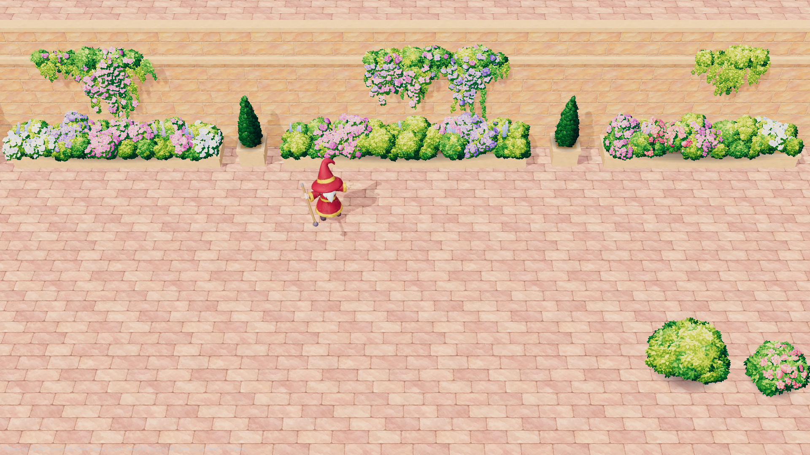
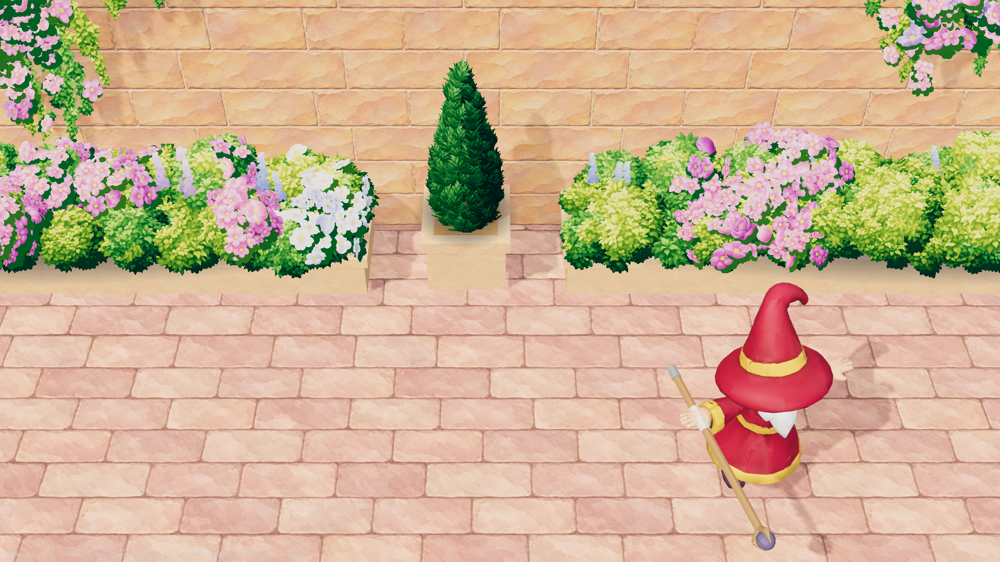
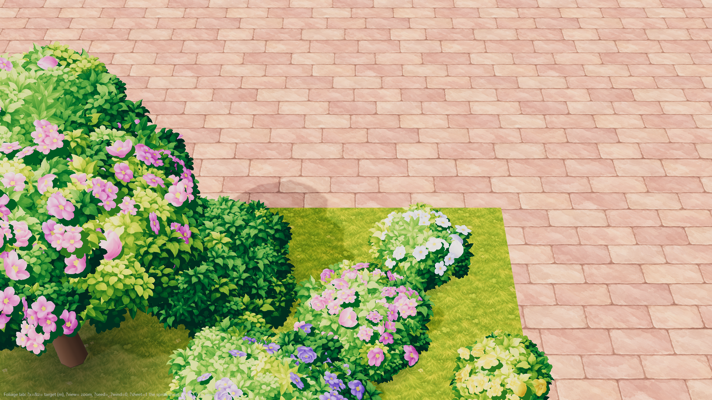
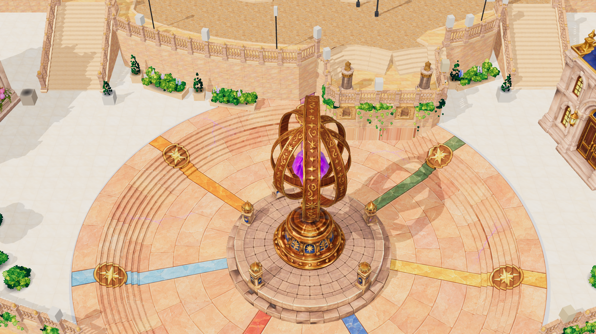

# Procedural foliage: plants grown in code

2026-11-24 · thread: [outdoor foliage](../threads/foliage.md) · code: `game/packages/client/src/lab/foliage.ts` · lab page: `foliage.html`

The user asked for a procedural foliage system that can reach the courtyard concept ([`area-courtyard-start.jpg`](../reference/element-order/area-courtyard-start.jpg)), built with fresh eyes, and allowed this session to bend the "no code-drawn art" rule: "that rule just exists because historically code drawn art has been very bad, but that's not necessarily the case for well crafted procedural stuff." The user's first verdict (2026-11-24): "It looks significantly better. My main critique is that the flowers look a bit flat", fixable perhaps with better shading and varied angles, and Codex-painted sheets were welcome. Round 2 below answers that; the pictures here are round 2.

## What it looks like

In the courtyard scene (pale paving and grey stand-ins are the courtyard's own open work):

## What the concept's greenery is

Read off the concept: five kinds, and none is a flat thing on a wall.

| Kind | Where | Size beside a wizard |
|---|---|---|
| Flower beds | stone troughs at the foot of retaining walls | knee to waist high, 3 to 6 m long, blossoms in drifts of one colour |
| Clipped cones | square planters at bed ends and door flanks | 1.5 to 2 m, dark, the scene's vertical accents |
| Hanging vines | from under a balustrade, in a few uneven drops | 1 to 2.5 m long, a full mass with blossom in its middle |
| Shrubs and small trees | the court's outer corners, in groups | waist high to 3.5 m, yellow-green tops, deep green undersides |
| Window boxes | under windows | a short bed with trailing ends (not built yet) |

Every mass is lit as one rounded form: yellow-green where the sun lands, blue-green in shade, with dark gaps between plants. Leaves and blossoms are drawn about twice life size, so they still read at the game camera.

## How a plant is made

1. **A plant is a clump of lobes** (ellipsoids, a cone, hanging strands). A recipe places the lobes with a seeded random stream: a shrub is a main mass with smaller ones at its foot; a bed packs plants of three sizes, taller at the back.
2. **Cards cover the lobes' outside.** Each card is a small square that always faces the camera. A card inside a neighbouring lobe is dropped, so a clump has one skin. Each card takes its lobe's surface direction for lighting, so the whole bush shades like one soft form.
3. **Colour comes from a ramp.** A card's sprite is a grey picture (a clump of leaves, a tuft, a blossom, a spike). Leaves and blossoms are painted by Codex in greys (round 2); spikes and the dark cores are still drawn in code. The shader adds up sunlight, the sprite's grey and how deep the card sits in the plant, and looks the sum up in an eight-step palette from blue-green shade to yellow highlight. One sheet serves every species and colour.
4. **Blossoms gather in drifts**: a few spots per plant where they are thick, thinning away, one colour per drift.
5. **Depth**: a dark core inside each lobe shows through the gaps, cards in the fold between two lobes are darker, hidden lobes cast the plant's shadow (and shade its own far side), and a soft dark patch sits on the ground under it.
6. **Wind** leans each card a little, more toward a plant's top and a vine's tips.

Recipes: `bush`, `bed`, `cone`, `cascade` (a vine over a wall's top), `tree`. Sizes are in metres. Same recipe and seed, same plant.

## Round 2: flowers with form (2026-11-24)

The first blossoms were flat discs: every one faced the camera, drawn from one code-made picture, lit the same. Changed:

- **Painted sheets.** Codex painted two grey sheets of sixteen sprites each: blossoms (four from the front, four in three-quarter view, a side-on cup, a half-open one, a bud, a rose, four bunches) in white with golden eyes, and leaf clumps (broad, round, upright tufts, hanging sprays). `tools/kit/foliage_sheets.py` keys them, stretches the greys and centres each sprite (`game/content/generated/textures/foliage-blossoms.png`, `foliage-leaves.png`). The palette ramp still gives the colour, so one white blossom sheet makes pink, lilac, white, rose and yellow flowers.
- **Angles.** Each blossom faces its own way, and the shader squashes its card along the way it leans, so a front-view blossom on the side of a bush is drawn as the oval it would show. About four in ten are front faces tilted this way, three in ten painted three-quarter or side views, the rest bunches.
- **Shading.** A blossom now takes more of the sun and its depth in the plant, and every card is a little lighter on its sunward side.
- **A shadow under each blossom**: the same shape in the leaf's deep tone, shifted down and away from the sun, so the flower stands off the leaves.

If the painted sheets are missing, the code-drawn sprites are used.

## In the kit

- A set piece with a `"grow"` recipe in `tools/kit/kit.json` is grown instead of loaded: `setpiece.bush-gold`, `-pink`, `-lilac`, `-white`, `setpiece.flowerbed`, `setpiece.flowerbed-long`, `setpiece.topiary`, `setpiece.tree-bloom`. They are placed with the editor's Prop tool like any set piece, and each differs by where it stands. A recipe's `box` adds a stone trough or planter under the plant.
- The four `vine.*` pieces have a `grow` cascade, so the dressing rules' vines are now grown, one per wall section. Removing `grow` brings back the painted strips.
- A planter's plant part (`plant-topiary`, `plant-cypress`, `plant-flowers`, `plant-blossom`) is grown where no model exists.
- The courtyard scene has two beds with topiaries under the west terrace wall, one east of the balcony, and a tree with shrubs in each lower corner of the plaza.

## Paving

A warm flag texture, `cobble` (Codex, prompt in `tools/concept-gen/prompts/2026-11-24-foliage/`). Codex painted it brick red; the game's copy is re-toned locally toward the concept's rose-tan. The lab uses it with `?floor=cobble`. The courtyard's floors are unchanged: that choice belongs to the courtyard thread.

## What it costs

- Camera-facing cards look right from the game camera and while orbiting in the editor, but a plant has no true silhouette detail up close: at twice the game's zoom the cards read as stamps.
- The painted leaf clumps are upright, so leaf cards now only lean up to about 45 degrees either way; a bush seen from straight above would show leaves all pointing "up the screen".
- Each blossom is two cards (itself and its shadow).
- A vine on a curved wall is laid along each section's straight chord, so it can cut a corner on a tight curve.
- Not measured for speed yet. The lab stage is about 30 plants with one draw call each for cards.

## Open

- The user's verdict against the concept, at the game camera.
- Painted spikes (lavender, delphinium) to match the painted blossoms.
- Window boxes, plants between paving stones, climbers growing up from a wall's foot.
- Merging a scene's plants into few draw calls if it becomes slow.
