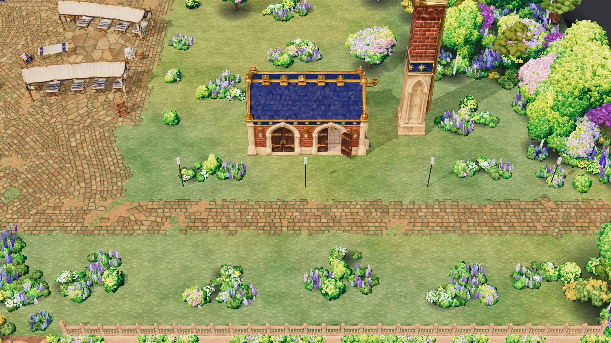
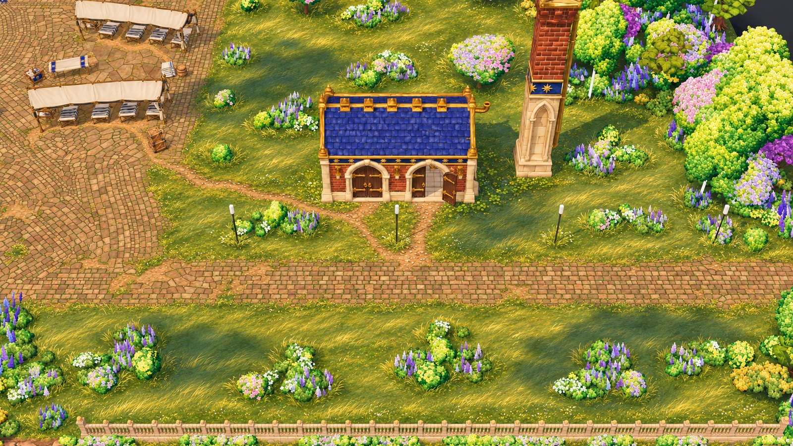
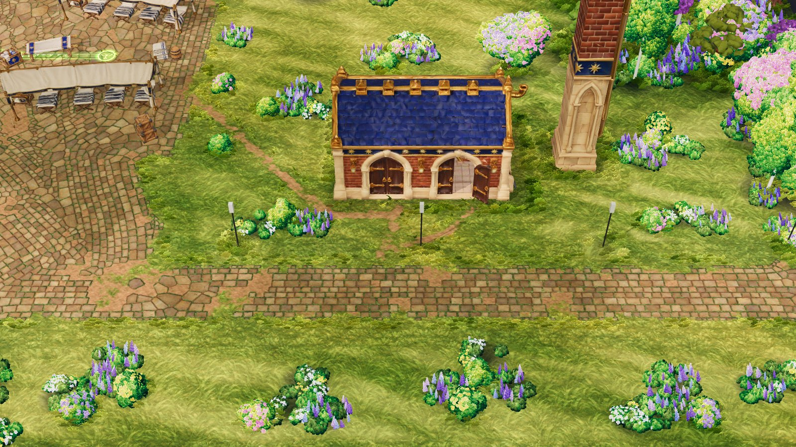

# Grass fields: research and concepts

2026-11-27 · thread: [outdoor foliage](../threads/foliage.md) · started from [the infirmary on the kit](../threads/infirmary-kit.md) · branch `worktree-grass-look` (off `worktree-infirmary-kit`, merged back there when done)

The user, working on the infirmary: "I see the need to do a deep dive on how we can make grassy fields look beautiful and natural ... this is the first time we're dealing with large patches of grass. I want to really make this look beautiful, because I expect a lot of the game to have this type of background." The earlier [procedural foliage](2026-11-24-procedural-foliage.md) work grew beds, bushes and vines; it never made open lawn.

This page is round 1: what the options are, and concept art to pick a look from. Nothing is built yet.

## Where we are

The `meadow` floor (2026-11-27): one Codex-painted tile, toned down and drifted in colour by `LAWN_VARY` in `game/packages/client/src/lab/kit-stones.ts` (straw-warm to blue-green over about 20 u, lusher patches, a soft mottle). Scattered long-grass tufts were tried the same day and dropped: they read as spots.

What makes it look like felt:

- **One scale of detail.** The tile has fine grain and the drift has a big wash, with nothing in between. Real grass at this distance reads as **clumps and tufts of 30 cm to 1 m**, each lit on its sunny side with a dark gap beneath. The concept is made of exactly that.
- **Nothing moves.** A lawn in wind shows moving bands of light; under clouds it darkens in passing patches. A still flat colour reads as carpet.
- **Hard, clean edges.** Grass stops at paving and props as if cut out. In the concept it frays into the stones, grows longer round posts and walls, and wears to earth where people walk.
- **No story in the ground.** No worn paths, no shade lawns, no dry patches: the same lawn everywhere.

## What the camera means for grass

Our camera is high and steep. Seen from about 55°, a blade is a few pixels long and you mostly see its top. So:

- **Individual blades barely read.** The thousands of blades in Ghost of Tsushima or a Genshin field sell themselves through their silhouettes against the sky at a low camera, and we never see that. At our scale, single blades shimmer more than they add.
- **What reads is colour, clumps, moving light and edges.** That's good news: most of it is cheap shader work and placement, not geometry.
- **Height shows only at edges and on slopes.** Long grass reads as long where it meets something (a path, a wall, a wizard's legs) and through its wind sheen.

## The approaches

Ordered roughly from cheapest to dearest. Costs are estimates for a basic laptop GPU, not measured.

| | How it works | From our camera | Cost | Art it needs |
|---|---|---|---|---|
| **1. Better painted ground** | The tile repeats in random hex patches (hex tiling) so no grid shows; a mid-scale clump mask (30 cm to 1 m) shades tufts light-over-dark; macro colour drift (have it); baked ambient occlusion under props and walls; a splat map for worn earth, shade lawn, dry patches | Fixes most of the felt look on its own | Nearly free: a few texture reads | 2 to 4 painted tiles (lawn, long, dry, worn), Codex |
| **2. Moving light** | Cloud shadows: a big soft noise scrolling over the whole level, darkening ground and plants alike. Wind sheen: brightness bands rolling across long grass in the same gusts our foliage already sways with | Large, calm movement: the thing that makes a field feel alive from above | Nearly free | None |
| **3. Painted tuft cards** | Small camera-facing cards (as our bushes are), each a painted clump of grass, scattered in thousands; coloured from the ground under them at the root and lit by the *ground's* normal, so they merge into the lawn instead of standing out as objects | Gives real height at edges and in long grass; when lit like the ground, they don't read as spots (the cause of today's dropped tufts) | Moderate: 20 to 60 thousand cards, alpha-tested | A sheet of grass clumps (short, long, seed-heads, clover), Codex |
| **4. Instanced blades** | Every blade a few triangles, bent and swayed on the GPU (Tsushima, the Codrops tutorial) | Wasted on a field seen from above; good for hero spots (a meadow edge, long grass round a ruin) | High per area | None (shaped in code) |
| **5. Shell texturing** | The ground drawn 8 to 16 times, stacked like fur shells | A velvety moss or clipped lawn; reads as CG fur on a meadow | Fill rate × shells | None |
| **6. Interaction** | One small top-down texture over the level records trampling, burning, frost and wet; the ground and the cards read it | Wizards leave trails; Fire scorches, Cold frosts, Water darkens the grass: our elements written on the field | Small: one 256² target | None |

**Recommendation for round 2: approaches 1, 2 and 3, in that order**, with 6 on top once spells meet grass. Do 1 and 2 first: they're cheap, every grassy level gets them, and they may already be enough for a clipped lawn. Then add tuft cards where grass is long or meets an edge. Keep true blades (4) for hero spots only, and skip shells (5) for open ground.

The other layer is **design, not rendering**: where grass is long, worn, shaded or dry is level dressing, painted in the editor as a splat (as paving is laid). That's what makes the concept's ground tell you where people walk.

## Concept art

Nine Codex pictures (free; prompts in `tools/concept-gen/prompts/2026-11-27-grass/`, originals in `.reference/grass-2026-11-27/`). Six repaint our own frame with only the grass changed, so the comparison is fair; two imagine open country; one combines the best ideas. They are on the review page, [Grass Fields](https://claude.ai/artifact/929TTjs5Xjoo86f1qaHDiE), with a slider against today's frame and marks for the user.

| | Asked for | My read |
|---|---|---|
| [p1](../reference/grass/p1-concept.jpg) the concept's grass | short dense tufts in the concept's olive, worn earth, frayed road edges | closest to the concept; over a big area a little busy and yellow |
| [p2](../reference/grass/p2-tall-meadow.jpg) tall meadow | knee-high meadow in wind, mown strips along paths | the most alive; the sheen bands are the moving-light idea; bright |
| [p3](../reference/grass/p3-blades.jpg) upright blades | a carpet of standing blades, cloud shadows | the cloud shadows carry it; the blades read only as velvet, which confirms blades are texture from our camera |
| [p4](../reference/grass/p4-soft-shapes.jpg) soft masses | an animated-film background of pillowy clumps | calm and graphic; lumpy over a large field |
| [p5](../reference/grass/p5-lived-in.jpg) lived in | worn footpaths, long tufts at the foot of things, clover in shade, molehills | the most natural, and mostly placement, not rendering |
| [p6](../reference/grass/p6-edges.jpg) edges | grass meeting the forecourt's paving | too little lawn in the frame to show much |
| [p7](../reference/grass/p7-countryside.jpg) countryside | open country: meadow, pasture, dry-stone walls, oaks, a stream | a mood target; the camera came out lower than ours |
| [p8](../reference/grass/p8-grass-palette.jpg) nine grounds | lawn, clover, meadow, dry, shade-moss, reeds, heath, path, cobble edge | a vocabulary for regions; drawn closer than our camera |
| [p9](../reference/grass/p9-combo.jpg) combined | p1's colour, p5's paths and rings, p3's cloud shadows, p2's sheen where the grass is long | **my pick**: the recommended layers together |

What the set says, across all nine:

- **Cloud shadows do more than anything else** (p3, p9): they give a flat lawn depth and scale for almost nothing.
- **Long grass rings round anything standing on the lawn** (p5, p9) root bushes, posts and walls in the ground. Our bushes look set down on felt because they have none.
- **Worn paths tell you where people go** (p5, p9). That's level design, painted per place.
- **Colour should stay the concept's olive and warm yellow-green** (p1, p9); the saturated greens of p2 and p3 drift away from it.
- **Individual blades add nothing** from this camera (p3).

## The user's answers (round 1)

- Lead: **p9, the combined look**. On p8, the nine grounds: "I do think we need to add more ground variations later, it's helpful if techniques are reusable."
- Moving light: **both** cloud shadows and wind sheen. Build first: **the infirmary**. Scope: **go** (ground and light first, then tufts).
- Then: "To be able to work more independently from me, you can lean on a codex reviewer to give you feedback until you think it's in a good state. If you think you're plateauing you can also try utilizing an advanced codex model as an advisor."

## Round 2: built in the game

Before: [this morning](../reference/grass/r2-before-road.jpg). Also [close](../reference/grass/r2-close.jpg), [the lower field](../reference/grass/r2-low.jpg), [the whole infirmary](../reference/grass/r2-wide.jpg). On the review page with sliders.

All of it lives in `game/packages/client/src/lab/kit-ground.ts`, which is reusable for any painted lawn:

- **Hex tiling** of the lawn tile, after Mikkelsen 2022: three samples at random offsets on a triangle lattice, so a 5 u tile never shows a grid.
- **A ground map** built from the compiled scene (`buildGround`), one texel per half u. R: worn to earth. G: long grass, which grows away from paving and paths, in rings round what stands on the lawn, and where a `grass-long` patch was placed. B: contact shade at the foot of props. A: distance from hard ground.
- **Painted tufts**: a Codex sheet of 16 grey tufts (`foliage-tufts.png`; prompt `tools/concept-gen/prompts/2026-11-27-grass/tufts.txt`), stamped over the ground by texture bombing and coloured by the lawn under them. Short tufts cover the lawn, big combed ones the long grass, and sparse ones a path's fringe.
- **Sweeps**: long warm shoulders of grass beside cool olive hollows, about 8 × 1.6 u, warped and running with the wind. This was the advisor's suggestion and the biggest single gain: it turned the lawn from carpet into painted strokes.
- **Long grass** is straw out in the open and lush, deep green at the foot of things. Its sheen rolls with the foliage's gusts.
- **Worn footpaths** are a new scene object, `{kind: wear, pts, w}`, compiled to `ground.wear` and painted to bare earth with ragged edges. The infirmary has three, from the boiler house's doors.
- **Margin grass** (`marginGrass`) is raised fans on camera-facing cards, one quad per fan, at the grass side of paving and walls, a path's shoulder and the foot of props. Runs are broken by noise, and each fan is coloured by the ground at its root and lit with the ground's up normal. Open lawn gets none, so it never reads as spots (the problem with the `patch` cards).
- **Cloud shadows** (`cloudify`) cover every lit material, ground, plants and roofs together. They take most of the sun and leave a cool tint.

How it was judged: five rounds with a Codex critic (`gpt-6.1-terra`) on a sheet of the target, the render, a close-up and the lower field, plus one advisor round (`gpt-6.2-astra`, extra-high reasoning) when the critic's score stalled at 5 to 6. The answers are in [critiques/](../reference/grass/critiques/). Scores went 5, 5, 6 (plateau, advisor), then 6.5, with "presentable to the art lead as a first in-game version". Where I overruled the critic:
- Its lifted tuft contrast flattened the tufts, and its paler clouds vanished, so both were tempered.
- Its long-grass thresholds would have made the whole lawn long; the target keeps short grass round paths and buildings.
- Its warmer earth brought back an orange stripe.

What it costs: the lawn's fragment shader does about 30 texture reads (hex tiling 3, three bomb layers of up to 9 each, the map, noise), and there are a few thousand margin quads. It isn't measured yet on the user's laptop; the bomb layers are where to save if needed.

## Next

- Round 3 (waiting on the user's marks): the critic's last notes, applied and rendered. They are in [r5-answer.md](../reference/grass/critiques/r5-answer.md): deeper olive hollows, fewer and calmer tuft stamps, a sparser and shorter margin fringe.
- **Ground types**, after the advisor (in [advisor-r4-answer.md](../reference/grass/critiques/advisor-r4-answer.md)). Replace the `mat === 'meadow'` test with a lookup. Each type names a painted tile and scale, a worn substrate, a value ramp, its tuft-sheet rows, its sweep size, wind strength and margin density. Dry grass, heath, moss and reeds would come next, from p8's vocabulary. Levels would paint types and wear in the editor.
- Spells on grass: one small top-down map of trample, scorch, frost and wet that the ground and margin cards read.
- Measure the cost on the user's machine.

## Sources

- [Procedural Grass in Ghost of Tsushima](https://gdcvault.com/play/1027214/contactUs), Eric Wohllaib, GDC 2021 Advanced Graphics Summit: blades by the million, within memory budgets.
- [Practical Real-Time Hex-Tiling](https://jcgt.org/published/0011/03/05/paper.pdf), Morten Mikkelsen, JCGT 2022, and [the demo code](https://github.com/mmikk/hextile-demo): three texture reads hide a tile's repeat.
- [How to make the fluffiest grass with three.js](https://tympanus.net/codrops/2025/02/04/how-to-make-the-fluffiest-grass-with-three-js/), Codrops 2025: alpha-cut cards, chunked LOD, shadow-mixed stylised shading. Our stack.
- [al-ro's grass](https://al-ro.github.io/projects/grass): instanced WebGL blades with wind.
- [Fur/grass with shell texturing](https://godotshaders.com/shader/fur-grass-with-shell-texturing/), after Acerola's video on shell texturing.
- [Meadows: creating stylised nature in UE4](https://80.lv/articles/meadows-creating-stylized-nature-in-ue4/), 80.lv: grass with flattened normals so it shades like the ground (the Breath of the Wild look).
