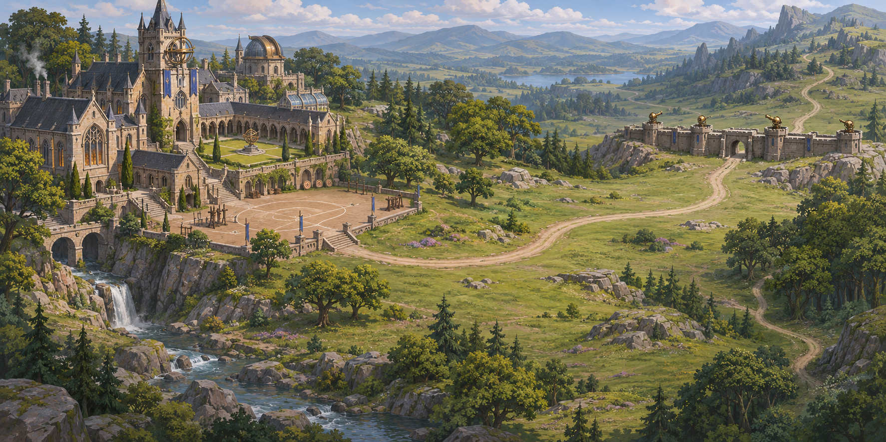

---
cssclasses:
  - ws-polished
  - ws-home
---

# Wizard Sim

*The Academy and the road to the battery · concept art*

## Current design and build

> [!catalogue] Current design and build
>
> > [!atlas] World and campaign
> > [World atlas](world/world.md) · [Story canon](campaign/canon.md) · [Campaign workflow](campaign/README.md)
>
> > [!magic] Spells and tuning
> > [Spell balance](systems/spell-balance.md) · [Element essences](world/elements.md)
>
> > [!fieldwork] Creatures and sound
> > [Bestiary](encounters/bestiary.md) · [Sound direction](presentation/sound.md)
>
> > [!workshop] Vision and playable build
> > [Design pillars](vision.md) · [Current state](current-state.md)

## In progress

> [!in-review] Active reviews
> [Campaign opening](work-in-progress.md#campaign-opening) · [Sound design reviews](work-in-progress.md#sound-design)

## Reference

[Ideas and project history](archive/README.md) · [Maintaining the vault](maintaining-the-vault.md)
